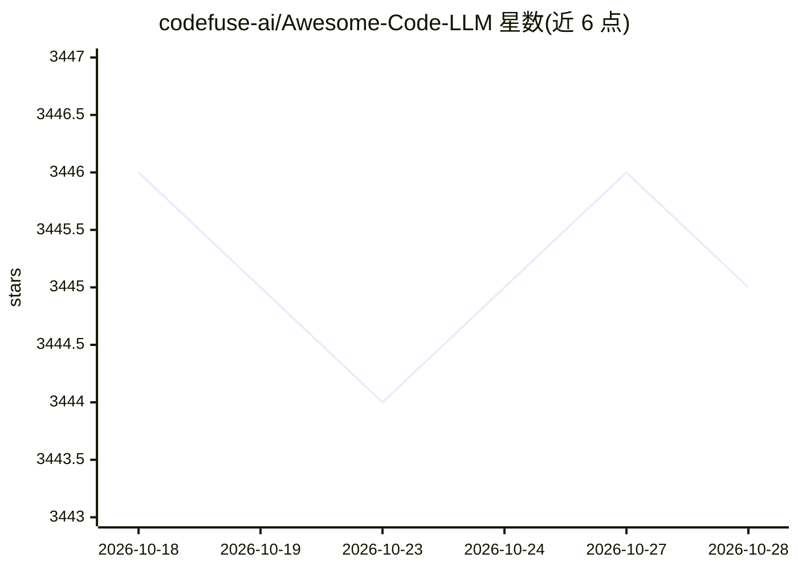

# codefuse-ai/Awesome-Code-LLM

⭐ 3,445 · 推送 2026-05-20 · [GitHub](https://github.com/codefuse-ai/Awesome-Code-LLM) · [官网](https://arxiv.org/abs/2311.07989) · 组织维护 · 中文 README

**代码大语言模型研究论文与数据集策展清单（TMLR 综述配套）**

配合 TMLR 综述论文《Unifying the Perspectives of NLP and Software Engineering》维护的代码 LLM 研究策展仓库，按综述、基础模型与预训练策略等分类收录论文条目及链接，并持续更新（如新增 EMNLP 2025 论文 67 篇）。条目含论文、代码仓库、模型与数据集链接。面向软件工程与 NLP 研究者与开发者，用于检索代码智能领域文献。通过提交 issue 补充或修正条目。

## 筛选速览

| 维度 | 判定 | 备注 |
|---|---|---|
| AI 角色 | `ai-knowledge` | 知识聚合/清单类 |
| 许可风险 | `none` | — |
| 部署形态 | `None` |  |
| 模型依赖 | — | README 未给出锁定关系 |
| 硬件要求 | — | 无带数字的原话,不猜 |
| 安装摩擦 | `low` | 无编译、无系统依赖或容器化 |
| 成熟度 | — | 结构信号不足 |

## 能力要点

- TMLR 综述论文配套的论文策展清单
- 按分类组织：综述、基础 LLM 与预训练策略等
- 条目附论文/代码/模型/数据集链接
- 持续更新会议论文（如 EMNLP 2025 新增 67 篇）

## 适用场景

- 查找代码 LLM 与软件工程 AI 领域的论文
- 了解基础模型与预训练策略研究脉络
- 追踪该领域新发表的会议论文

## 场景标签

`精选清单` `科研工具` · 领域:学习与行业

## 证据(README 行号)

> L3: This is the repo for our TMLR code LLM survey. If you find this repo helpful, please support us by citing:
> L44: 1. "Large Language Models Meet NL2Code: A Survey" [2022-12] [ACL 2023] [paper]

## 星数曲线

2026-10-18 3,446 → 2026-10-28 3,445（-1）

---
*卡片 v1 · prompt 1.4 · 生成 2026-10-20 · 置信度 high · 依据 README sha `6f226d47a60b` · [字段定义](../../DATASET.md)*
