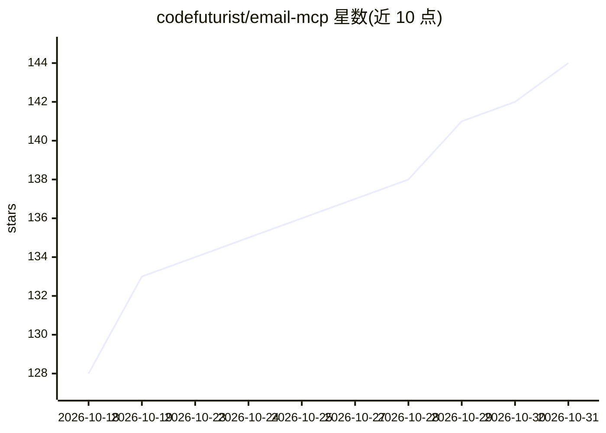

# codefuturist/email-mcp

⭐ 144 · TypeScript · LGPL-3.0 · 推送 2026-10-29 · [GitHub](https://github.com/codefuturist/email-mcp) · 个人维护

**给 AI 助手的邮件 MCP 服务器：IMAP+SMTP 收发管理邮件**

基于 MCP TypeScript SDK v2 的邮件服务器，通过 IMAP 与 SMTP 让 AI 助手读取、搜索、发送、调度与管理多个邮箱账户。暴露 52 个工具、7 个提示与 6 个资源，支持 stdio 与 Streamable HTTP 两种传输；提供定时发信、IMAP IDLE 实时监视与 AI 分诊、验证码捕获复制到剪贴板、ICS 日历提取、统计分析、预设规则与向导式配置（自动探测 Gmail/Outlook/Yahoo/iCloud/Fastmail/ProtonMail/Zoho/GMX），OAuth2 为实验性。安装途径含 npx、Homebrew、Bun 编译单文件二进制、Docker 镜像与 mise；自带二进制自更新命令。

## 筛选速览

| 维度 | 判定 | 备注 |
|---|---|---|
| AI 角色 | `ai-ecosystem` | LLM/agent 周边工具 |
| 许可风险 | `viral` | LGPL-3.0 |
| 部署形态 | `self-host` | docker 或自建部署 |
| 模型依赖 | — | README 未给出锁定关系 |
| 硬件要求 | — | 无带数字的原话,不猜 |
| 安装摩擦 | `low` | 无编译、无系统依赖或容器化 |
| 成熟度 | `idea` | |

## 能力要点

- 52 个 MCP 工具覆盖读/搜/发/管/调度/分析全流程，多账户并行
- IMAP IDLE 实时监视、AI 分诊与验证码捕获自动复制剪贴板
- stdio 与 Streamable HTTP 双传输，可作后台常驻服务并登录自启
- 提供 npx/Homebrew/Docker/Bun 单文件二进制/mise 多种安装方式，二进制支持自更新

## 适用场景

- 在 Claude Desktop、Cursor 等客户端中让 AI 助手代为收发和管理邮件
- AI 分诊新邮件并按预设规则整理多账户邮箱
- 让 AI 捕获邮件验证码并自动复制，简化登录流程

## 场景标签

 · 领域:AI 助手/邮件工具

## 证据(README 行号)

> L9: An MCP (Model Context Protocol) server providing comprehensive email capabilities via IMAP and SMTP.
> L11: Enables AI assistants to read, search, send, manage, schedule, and analyze emails across multiple accounts. Exposes

## 星数曲线

2026-10-18 128 → 2026-10-31 144（+16）

---
*卡片 v1 · prompt 1.4 · 生成 2026-10-22 · 置信度 high · 依据 README sha `9fa53bf3e6d9` · [字段定义](../../DATASET.md)*
