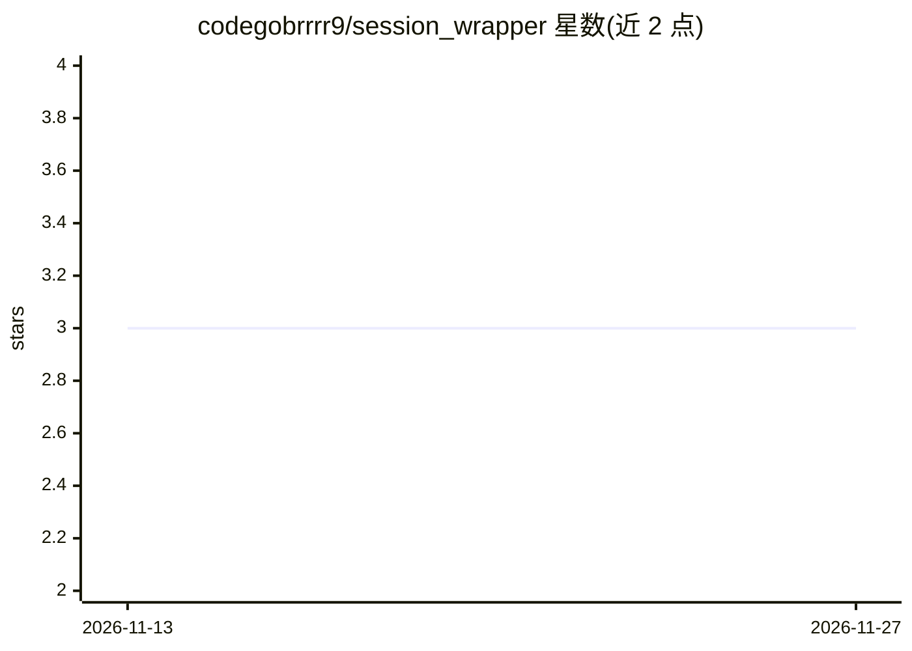

# codegobrrrr9/session_wrapper

⭐ 3 · JavaScript · MIT · 推送 2026-11-08 · [GitHub](https://github.com/codegobrrrr9/session_wrapper) · 个人维护

**从 agent 会话日志提取可移植交接文件的工具**

session_wrapper 读取 Claude Code、Codex 等编码 agent 留在磁盘上的会话日志，用规则提取（不调用模型、不联网、零依赖）生成一份 Markdown 交接文件，内容含目标、决策、死胡同、改动文件、测试状态与待办，每条均引用可核验的轮次编号；`check` 命令回读日志校验引文。写入前对密钥形状字符串做启发式脱敏并二次扫描。通过 npx 运行，或作为 skill 装入五种 agent，另支持粘贴 ChatGPT/Claude.ai 导出文件。

## 筛选速览

| 维度 | 判定 | 备注 |
|---|---|---|
| AI 角色 | `ai-ecosystem` | LLM/agent 周边工具 |
| 许可风险 | `permissive` | MIT |
| 部署形态 | `library` | 以包/库形式分发 |
| 模型依赖 | — | README 未给出锁定关系 |
| 硬件要求 | — | 无带数字的原话,不猜 |
| 安装摩擦 | `low` | 无编译、无系统依赖或容器化 |
| 成熟度 | — | 结构信号不足 |

## 能力要点

- 读取本地会话日志直接提取交接文件，不调用模型、不联网、零依赖
- 每条内容引用会话轮次，check 命令可回读日志核验引文真实性
- 写入前/后双重密钥脱敏扫描，高/中风险命中时拒绝写出
- --budget 按固定步序压缩各节以控制 token 预算（默认 4,000）

## 适用场景

- 长会话上下文退化或配额耗尽后，把状态带给下一段会话
- 在 Claude Code、Codex 等工具之间切换时携带项目状态
- 把会话要点粘贴进普通聊天窗口继续讨论

## 场景标签

 · 领域:开发工具/agent 工作流

## 证据(README 行号)

> L5: Long sessions degrade, and switching tools means starting over. session_wrapper reads the session's log from disk an
> L13: The usual advice for switching agents is "ask the model to write a HANDOFF.md before you quit". That summary is wri
> L100: |**Claude Code**|`/plugin marketplace add codegobrrrr9/session_wrapper` then `/plugin install session-wrapper@sess

## 星数曲线

2026-11-13 3 → 2026-11-27 3（+0）

---
*卡片 v1 · prompt 1.4 · 生成 2026-11-22 · 置信度 high · 依据 README sha `c8986a8c6c1a` · [字段定义](../../DATASET.md)*
