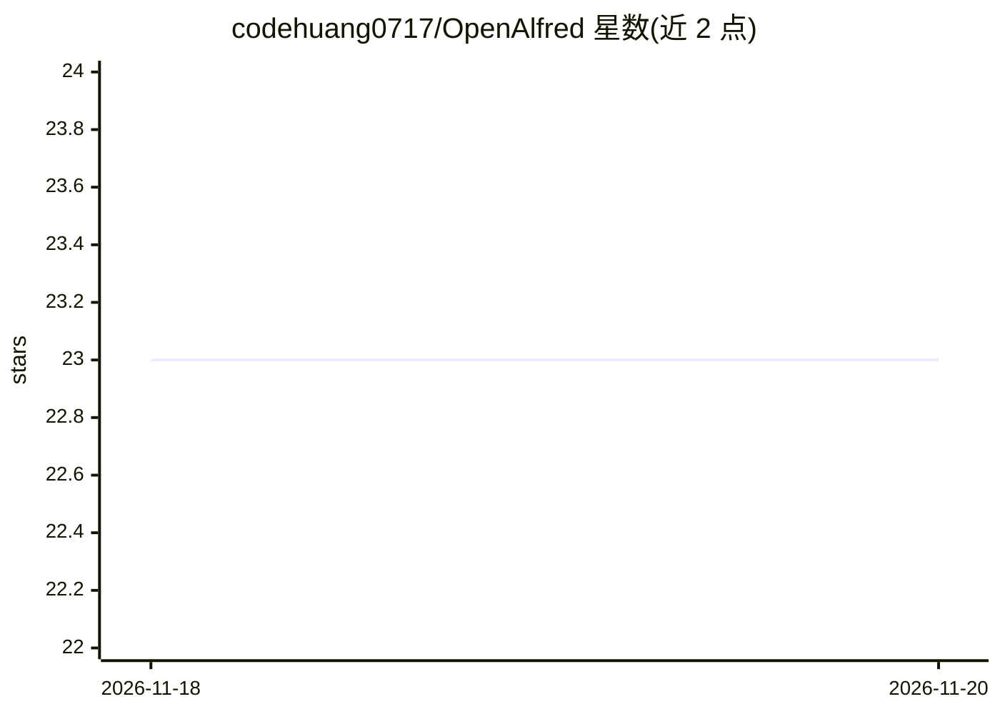

# codehuang0717/OpenAlfred

⭐ 23 · Python · 推送 2026-11-18 · [GitHub](https://github.com/codehuang0717/OpenAlfred) · 个人维护 · 中文 README

**自托管的学生 AI 学习助手：笔记问答、主动提醒、长期记忆**

面向学生与自学者的自托管 AI 助手应用，基于 Python/FastAPI/LangGraph 后端与 Next.js 前端。功能包括：Markdown/PDF 笔记上传后按标题分段、Gemini 多模态模型生成图片描述、BGE-M3 向量化入 ChromaDB，问答时引用原文与笔记原图；从对话提取 profile/preferences/patterns/relationship 四类长期记忆，以 Markdown 文件存储并可手动编辑；后台 Supervisor 定期截屏+OCR 由 LLM 判断活动与任务相关性，触发 Bark 推送或 SIP 语音来电提醒；支持自然语言生成 HTML/CSS/JS 小程序、邮件整理与回复草稿、语音通话（SenseVoice STT + Faster-Qwen3-TTS）、多模型切换（含 Ollama 本地 Gemma）。部署需 Python 3.13+、Node.js 20+、Redis、LiveKit Server 与至少一个 LLM API Key；TTS 语音 Docker 服务需 GPU。

## 筛选速览

| 维度 | 判定 | 备注 |
|---|---|---|
| AI 角色 | `ai-native` | 本体是模型或模型工具 |
| 许可风险 | `none` | — |
| 部署形态 | `self-host` | docker 或自建部署 |
| 模型依赖 | local-ok | 支持本地模型 |
| 硬件要求 | — | 无带数字的原话,不猜 |
| 安装摩擦 | `low` | 无编译、无系统依赖或容器化 |
| 成熟度 | — | 结构信号不足 |

## 能力要点

- 多模态 RAG：笔记分段+图片描述+BGE-M3 向量化，回答引用原文与原图
- Markdown 文件存储的长期记忆，透明可手动编辑
- Supervisor 截屏+OCR 监测学习状态，触发推送/语音来电提醒
- 自然语言生成小程序并发布到个人工具箱；支持 Ollama 本地模型

## 适用场景

- 上传课堂笔记和 PDF，按自己的资料提问并引用原图
- 考试节点、作业截止前收到主动提醒
- 让助手记住自己的学习偏好并跟踪任务进度
- 隐私优先场景用 Ollama 本地模型自托管部署

## 场景标签

`AI 助手` `文档问答` `Agent 记忆` · 领域:Agent 开发

## 证据(README 行号)

> L3:  面向学生与自学者的开源 AI 学习助手：主动提醒、记住学习偏好、结合笔记原图答疑
> L8: **OpenAlfred is an open-source, self-hosted AI study assistant and proactive personal AI agent for students and self
> L40: 如果你在找 **学生 AI 助手、大学生学习助手、AI study assistant、study companion**，OpenAlfred 把个人笔记问答、学习任务和主动提醒放进同一个助理。适用于课程学习、自学与复习，也可用

## 星数曲线

2026-11-18 23 → 2026-11-20 23（+0）

---
*卡片 v1 · prompt 1.4 · 生成 2026-11-18 · 置信度 mid · 依据 README sha `23377ce60f8a` · [字段定义](../../DATASET.md)*
