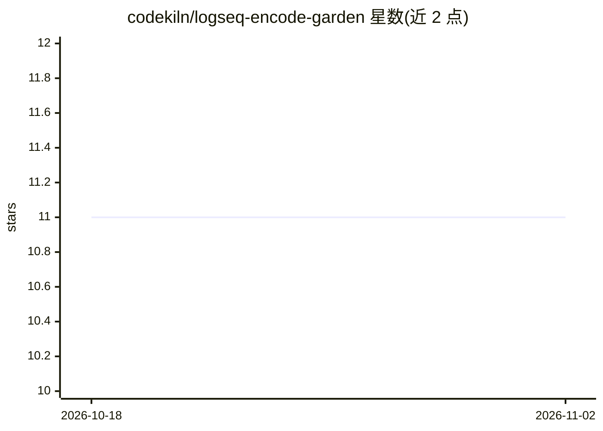

# codekiln/logseq-encode-garden

⭐ 11 · Python · 推送 2026-11-01 · [GitHub](https://github.com/codekiln/logseq-encode-garden) · [官网](https://codekiln.github.io/logseq-encode-garden/) · 个人维护

**个人 Logseq 知识库：可让 AI agent 基于其内容回答关于作者的问题**

维护者个人的 Logseq 知识花园（页面与日志），配套 AI agent 问答能力：通过 mise 运行 ask-my-agent-anything-about-me，脚本询问用户使用哪个 agent（Claude Code、Codex、Cursor、GitHub Copilot 或其他 AGENTS.md 兼容工具），为其安装技能并启动，agent 依据库内页面回答问题并引用出处。无 mise 时可直接在上述工具中打开该文件夹提问，AI 配置随库附带。README 另提供从零安装的分步指南。

## 筛选速览

| 维度 | 判定 | 备注 |
|---|---|---|
| AI 角色 | `ai-knowledge` | 知识聚合/清单类 |
| 许可风险 | `none` | — |
| 部署形态 | `None` |  |
| 模型依赖 | — | README 未给出锁定关系 |
| 硬件要求 | — | 无带数字的原话,不猜 |
| 安装摩擦 | `low` | 无编译、无系统依赖或容器化 |
| 成熟度 | — | 结构信号不足 |

## 能力要点

- 一键脚本为多种 AI agent 安装问答技能并启动
- agent 回答基于库内页面与日志并引用来源
- 支持 Claude Code/Codex/Cursor/Copilot 等 AGENTS.md 兼容工具

## 适用场景

- 克隆仓库后向 agent 提问了解作者
- 作为个人知识库加 agent 问答的参考实现

## 场景标签

`知识库管理` `文档问答` · 领域:知识与检索

## 证据(README 行号)

> L3: My little Knowledge Garden
> L22: `ask-my-agent-anything-about-me` skill that teaches the agent how to answer and

## 星数曲线

2026-10-18 11 → 2026-11-02 11（+0）

---
*卡片 v1 · prompt 1.4 · 生成 2026-11-02 · 置信度 mid · 依据 README sha `723ad76ceae2` · [字段定义](../../DATASET.md)*
