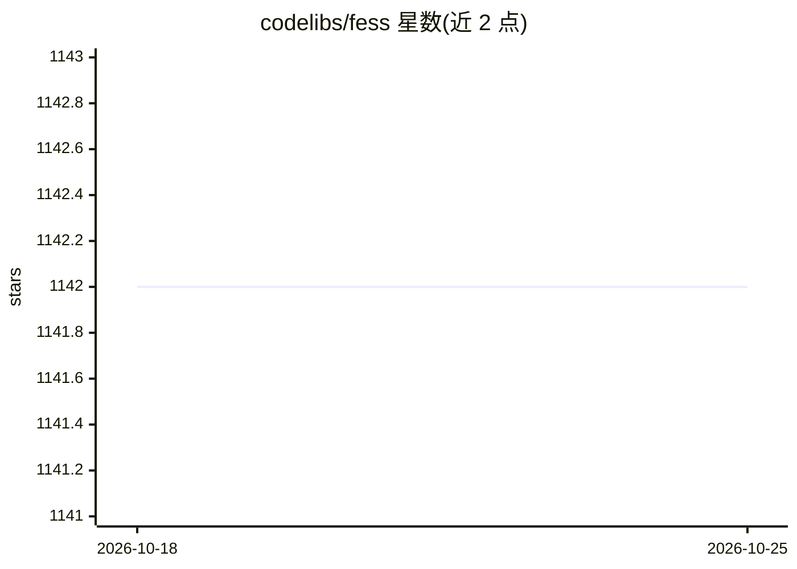

# codelibs/fess

⭐ 1,142 · Java · Apache-2.0 · 推送 2026-10-25 · [GitHub](https://github.com/codelibs/fess) · [官网](https://fess.codelibs.org) · 组织维护

**自托管企业/站内搜索服务器：爬取多源文档并提供全文检索**

基于 OpenSearch 的企业搜索服务器，内置爬虫可采集网站、文件系统与数据库/云存储/CSV 等数据源，支持 Microsoft Office、PDF、压缩包等格式。通过浏览器管理界面配置，提供 REST API、角色权限过滤、LDAP/OIDC/SAML 等单点登录，界面与文本分析覆盖 20+ 语言，可经插件扩展。仓库描述提及 AI/RAG 与语义搜索能力。安装形式包括 ZIP/RPM/DEB 包与 Docker 镜像；除 Docker 镜像捆绑 OpenSearch 外，需自行部署 OpenSearch 后端，ZIP/RPM/DEB 需 Java 21 或更高版本运行时。

## 筛选速览

| 维度 | 判定 | 备注 |
|---|---|---|
| AI 角色 | `ai-enhanced` | 去掉 AI 部分产品仍成立 |
| 许可风险 | `permissive` | Apache-2.0 |
| 部署形态 | `desktop` | 安装包/桌面程序 |
| 模型依赖 | — | README 未给出锁定关系 |
| 硬件要求 | — | 无带数字的原话,不猜 |
| 安装摩擦 | `low` | 无编译、无系统依赖或容器化 |
| 成熟度 | — | 结构信号不足 |

## 能力要点

- 爬虫支持网站、文件系统与数据库/云存储/SaaS 等数据源（Confluence、SharePoint、S3、Slack 等）
- 全文检索含分面、排序与搜索建议，角色/权限过滤搜索结果
- 支持 LDAP、OpenID Connect、SAML、SPNEGO、Microsoft Entra ID 单点登录
- 20+ 语言的界面与文本分析，插件机制扩展数据源与主题

## 适用场景

- 企业内部对网站、文件服务器和数据库内容做统一检索
- 在自己网站中嵌入站内搜索（替代已停服的 Google Site Search）
- 通过 REST API 将搜索能力集成到其他系统

## 场景标签

`网页抓取` `语义搜索` · 领域:效率与自动化

## 证据(README 行号)

> L8: Fess is an enterprise search server that you can install and run on any platform with a Java runtime. It is built on
> L10: A built-in crawler collects documents from web sites, file systems, and data stores such as databases and CSV files

## 星数曲线

2026-10-18 1,142 → 2026-10-25 1,142（+0）

---
*卡片 v1 · prompt 1.4 · 生成 2026-10-21 · 置信度 mid · 依据 README sha `4d98aa646ed4` · [字段定义](../../DATASET.md)*
