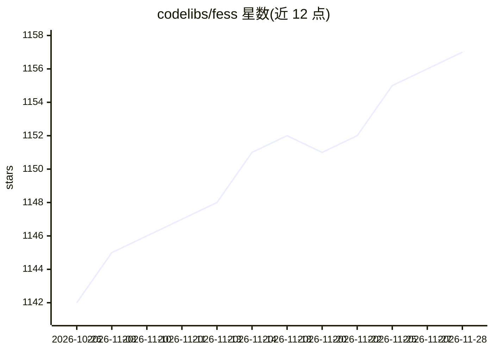

# codelibs/fess

⭐ 1,157 · Java · Apache-2.0 · 推送 2026-11-27 · [GitHub](https://github.com/codelibs/fess) · [官网](https://fess.codelibs.org) · 组织维护

**自托管企业搜索服务器：爬取多种数据源并提供全文/语义搜索**

基于 OpenSearch 构建的企业级搜索服务器，可运行在任何有 Java 运行时的平台，通过浏览器管理界面配置而无需 OpenSearch 知识。内置爬虫采集网站、文件系统、数据库、CSV 及云/SaaS 数据源（Confluence、SharePoint、S3、Salesforce 等 15+ 种），支持 Office/PDF/ZIP 等文档格式。提供全文搜索的分面、排序、建议，基于角色权限的结果过滤，LDAP/OIDC/SAML 单点登录，20+ 语言界面与文本分析，REST API 与插件扩展。提供 ZIP/DEB/RPM 包与 Docker 镜像。

## 筛选速览

| 维度 | 判定 | 备注 |
|---|---|---|
| AI 角色 | `ai-enhanced` | 去掉 AI 部分产品仍成立 |
| 许可风险 | `permissive` | Apache-2.0 |
| 部署形态 | `desktop` | 安装包/桌面程序 |
| 模型依赖 | — | README 未给出锁定关系 |
| 硬件要求 | — | 无带数字的原话,不猜 |
| 安装摩擦 | `low` | 无编译、无系统依赖或容器化 |
| 成熟度 | — | 结构信号不足 |

## 能力要点

- 内置爬虫覆盖 web、文件系统、数据库与 15+ 种云/SaaS 数据源
- 基于角色的搜索结果权限过滤与 LDAP/OIDC/SAML/SPNEGO/Entra ID 单点登录
- 20+ 语言的多语言界面与文本分析
- 浏览器管理 UI、REST API 及 data store/ingest/script/theme 四类插件扩展

## 适用场景

- 为企业内部文档和数据库搭建统一搜索入口
- 在官网嵌入站点搜索（Fess Site Search）
- 从 Google Site Search 等迁移自建搜索服务
- 爬取 Confluence/SharePoint/S3 等企业数据源建立索引

## 场景标签

`语义搜索` · 领域:知识与检索

## 证据(README 行号)

> L8: Fess is an enterprise search server that you can install and run on any platform with a Java runtime. It is built on
> L17: - Crawlers for web sites, file systems, and data stores (databases, cloud storage, and SaaS)
> L20: - Role- and permission-based filtering of search results

## 星数曲线

2026-10-26 1,142 → 2026-11-28 1,157（+15）

---
*卡片 v1 · prompt 1.4 · 生成 2026-11-24 · 置信度 high · 依据 README sha `effea9ef09f3` · [字段定义](../../DATASET.md)*
