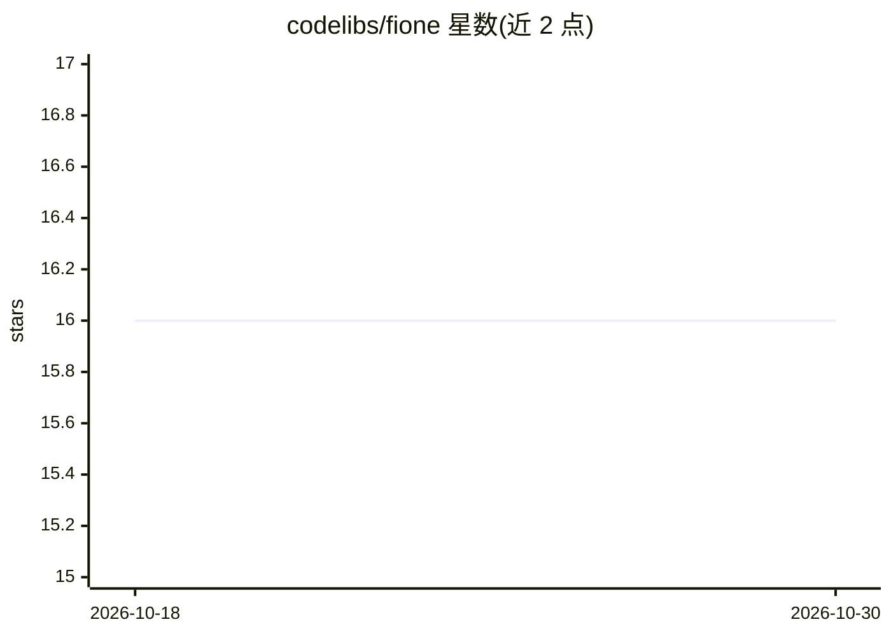

# codelibs/fione

⭐ 16 · Java · Apache-2.0 · 推送 2026-10-29 · [GitHub](https://github.com/codelibs/fione) · [官网](https://fione.codelibs.org/) · 组织维护

**面向 Fess 的企业 AutoML 扩展平台**

Fione 是搜索服务器 Fess 的 AutoML 扩展，定位为企业 AI 平台。README 仅提供概览与开发文档指引：详细文档位于 fione.codelibs.org，配套 docker-fione 仓库用于容器部署，社区讨论在 discuss.codelibs.org。开发流程为克隆 fione 与 fess 源码后经 devcmd.sh 脚本复制并启动，消息代码用 dbflute:freegen 更新，构建通过 Maven 打包并可生成 .rpm/.deb 安装包。README 未说明支持的算法或模型细节。

## 筛选速览

| 维度 | 判定 | 备注 |
|---|---|---|
| AI 角色 | `ai-ecosystem` | LLM/agent 周边工具 |
| 许可风险 | `permissive` | Apache-2.0 |
| 部署形态 | `None` |  |
| 模型依赖 | — | README 未给出锁定关系 |
| 硬件要求 | — | 无带数字的原话,不猜 |
| 安装摩擦 | `low` | 无编译、无系统依赖或容器化 |
| 成熟度 | — | 结构信号不足 |

## 能力要点

- 作为 Fess 的 AutoML 扩展运行
- Maven 构建并生成 .rpm/.deb 包
- 配套 docker-fione 仓库

## 适用场景

- 在 Fess 搜索服务器上增加 AutoML 能力
- 企业内部部署并二次开发 Fione

## 场景标签

`MLOps` · 领域:训练与推理

## 证据(README 行号)

> L6: Fione is AutoML extension for Fess.

## 星数曲线

2026-10-18 16 → 2026-10-30 16（+0）

---
*卡片 v1 · prompt 1.4 · 生成 2026-10-30 · 置信度 mid · 依据 README sha `3916ff661fbe` · [字段定义](../../DATASET.md)*
