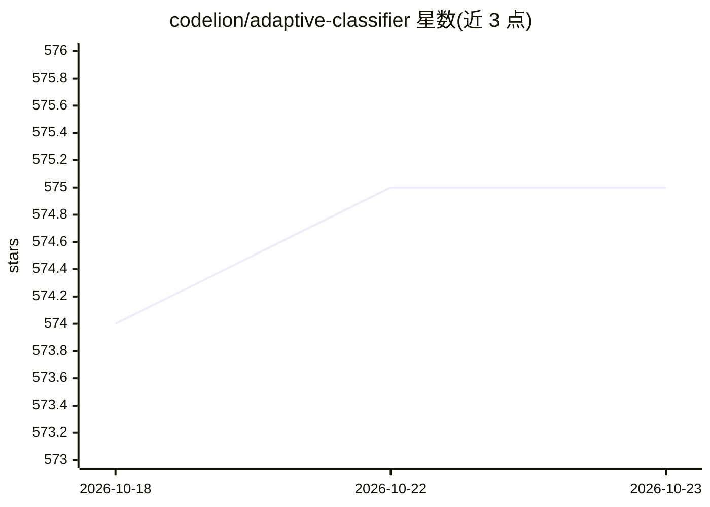

# codelion/adaptive-classifier

⭐ 575 · Python · Apache-2.0 · 推送 2026-10-09 · [GitHub](https://github.com/codelion/adaptive-classifier) · 个人维护

**支持持续学习与动态加类的自适应文本分类库**

基于 PyTorch 与 HuggingFace transformers 的 Python 分类库：运行时可新增类别、增量添加样本而无需整体重训（原型记忆 FAISS + EWC 保护的自适应神经头混合预测）。提供校准置信度、OOD 检测与弃权、遗忘错误样本、主动学习建议与漂移检测；支持战略分类（对抗输入防御）、多标签分类、scikit-learn 接口与内置 ONNX Runtime CPU 加速（保存模型可经 ONNX 在 C#/Node/浏览器运行）。以 pip 安装，提供 Colab 示例与 HTTP server、异步方法。限制：0.2.0 前默认 CLS pooling 不适用于多数编码器，旧存档模型行为不随版本升级变化。

## 筛选速览

| 维度 | 判定 | 备注 |
|---|---|---|
| AI 角色 | `ai-native` | 本体是模型或模型工具 |
| 许可风险 | `permissive` | Apache-2.0 |
| 部署形态 | `self-host` | docker 或自建部署 |
| 模型依赖 | — | README 未给出锁定关系 |
| 硬件要求 | — | 无带数字的原话,不猜 |
| 安装摩擦 | `low` | 无编译、无系统依赖或容器化 |
| 成熟度 | — | 结构信号不足 |

## 能力要点

- 运行时动态新增类别与增量样本，无需整体重训
- 原型记忆（FAISS）与 EWC 保护神经头的混合预测（默认 0.7/0.3）
- 校准置信度、OOD 检测、弃权与主动学习建议、漂移检测
- 内置 ONNX Runtime CPU 推理（量化模型可在 C#/Node/浏览器运行）

## 适用场景

- 客服工单、查询分类等类别随业务不断新增的场景
- 生产环境零停机更新分类模型
- 需要对抗输入防御或检测幻觉/OOD 输入的部署
- 作为 LLM 路由器按查询难度分流模型

## 场景标签

 · 领域:机器学习/NLP 分类

## 证据(README 行号)

> L20: Adaptive Classifier is a PyTorch-based machine learning library that revolutionizes text classification with **cont
> L140: A prediction mixes two signals: the **prototype score** (how close the text is to each class's mean embedding) and

## 星数曲线

2026-10-18 574 → 2026-10-23 575（+1）

---
*卡片 v1 · prompt 1.4 · 生成 2026-10-21 · 置信度 mid · 依据 README sha `336bc54be810` · [字段定义](../../DATASET.md)*
