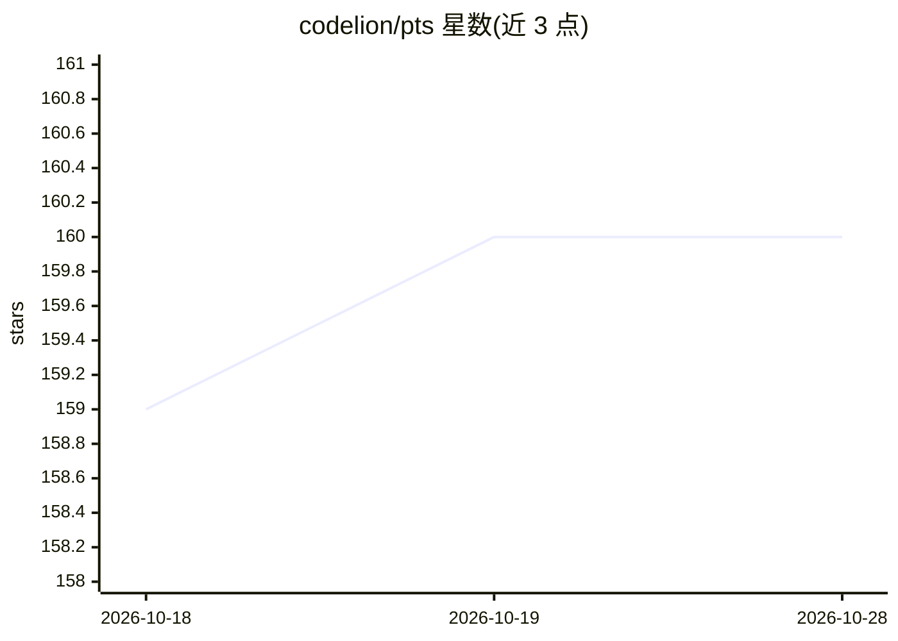

# codelion/pts

⭐ 160 · Python · Apache-2.0 · 推送 2026-09-24 · [GitHub](https://github.com/codelion/pts) · 个人维护

**模型推理关键事件的因果搜索框架：定位改变解题结果的 token/句/隐层概念**

PTS 将三种粒度的推理关键事件统一处理：隐层工作区概念（Latent，J-lens 读取）、已发射的关键 token（Token，源自 Phi-4 报告）、关键推理句（Sentence，源自 Thought Anchors）。通过对比事件有无时的成功概率差给事件打分，支持链接成链、导出 DPO 对与 steering 向量（对接 OptiLLM autothink）、上传 Hugging Face。核心库为纯 Python，模型代码按需加载；提供 CLI 与可视化器。隐层部分为基于论文方程的独立复现，未与原作者结果对齐验证。

## 筛选速览

| 维度 | 判定 | 备注 |
|---|---|---|
| AI 角色 | `ai-ecosystem` | LLM/agent 周边工具 |
| 许可风险 | `permissive` | Apache-2.0 |
| 部署形态 | `library` | 以包/库形式分发 |
| 模型依赖 | — | README 未给出锁定关系 |
| 硬件要求 | — | 无带数字的原话,不猜 |
| 安装摩擦 | `low` | 无编译、无系统依赖或容器化 |
| 成熟度 | — | 结构信号不足 |

## 能力要点

- 三种粒度（latent/token/sentence）统一事件评分与链接成图
- J-lens 读取中层工作区隐层概念，logit-lens 作为免校准备选
- 导出 DPO 对与 steering 向量，steering 向量接入 OptiLLM autothink
- `import pts` 不加载 torch/transformers，核心层为纯 Python

## 适用场景

- 分析推理模型中哪些 token 或推理句决定解题成败
- 生成 DPO 训练对与 steering 向量用于模型干预
- 检验隐层工作区概念与后续关键事件的对应关系

## 场景标签

`模型评测` `强化学习` · 领域:评测与运维

## 证据(README 行号)

> L21: PTS treats all three as the same thing at different scales. It searches for them,
> L105: |`pts run --granularity token\|sentence\|latent\|all`|Search for pivotal events|
> L110: |`pts export --format …`|`causal_events`, `metatokens`, `pivotal_tokens`, `thought_anchors`, `dpo`, `steering`|

## 星数曲线

2026-10-18 159 → 2026-10-28 160（+1）

---
*卡片 v1 · prompt 1.4 · 生成 2026-10-23 · 置信度 high · 依据 README sha `c8b40bf6a951` · [字段定义](../../DATASET.md)*
