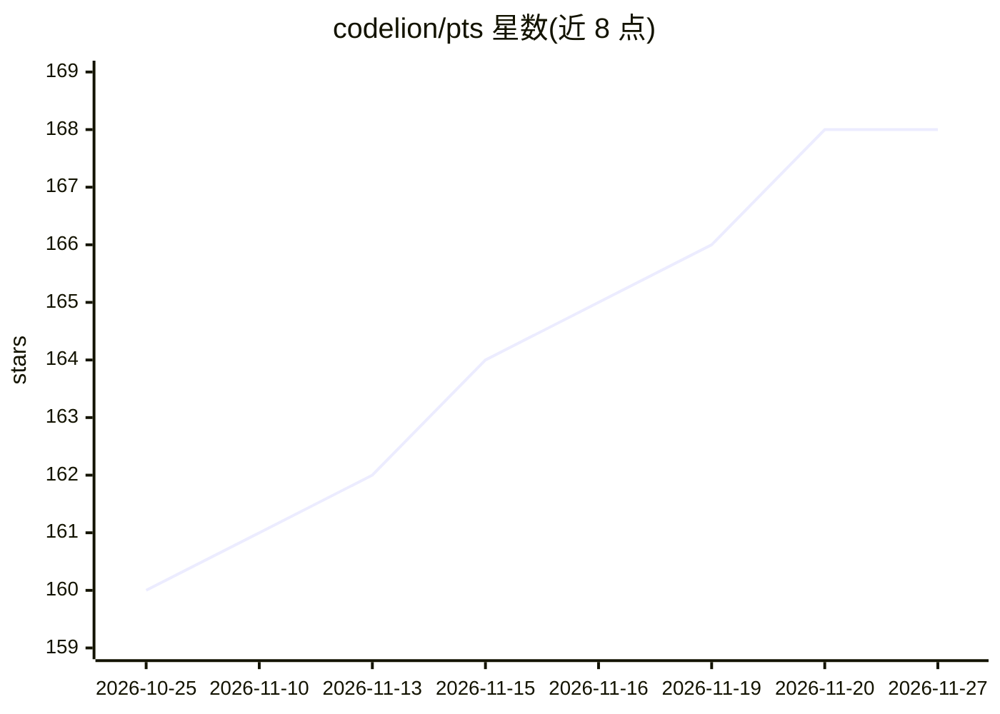

# codelion/pts

⭐ 168 · Python · Apache-2.0 · 推送 2026-11-07 · [GitHub](https://github.com/codelion/pts) · 个人维护

**面向研究者的模型推理关键事件搜索框架（PTS）**

PTS 是一个因果事件搜索框架，在潜在元 token、发出的关键 token、推理句子三个尺度上搜索并评分改变模型解题概率的推理事件，用统一公式 event_importance 打分并链接成图。以 Python 包形式提供 CLI 命令（run/enrich/fit-jlens/link/export/steer/serve 等），支持导出 DPO 对与推理模式数据集、构建与验证转向向量、运行带逐请求转向的 OpenAI 兼容服务。结果可在托管可视化器或本地 app.py 中查看。需要 Python 3.9+，Jacobian lens 为独立重实现，作者声明未对照原论文结果验证。

## 筛选速览

| 维度 | 判定 | 备注 |
|---|---|---|
| AI 角色 | `ai-ecosystem` | LLM/agent 周边工具 |
| 许可风险 | `permissive` | Apache-2.0 |
| 部署形态 | `library` | 以包/库形式分发 |
| 模型依赖 | — | README 未给出锁定关系 |
| 硬件要求 | — | 无带数字的原话,不猜 |
| 安装摩擦 | `low` | 无编译、无系统依赖或容器化 |
| 成熟度 | — | 结构信号不足 |

## 能力要点

- 三个尺度（潜在/token/句子）统一评分与事件链接
- 导出 DPO 对、推理模式、转向向量等多种数据格式
- pts serve 提供带逐请求转向的 OpenAI 兼容服务
- pts discover 在行为评测上自动生成并对照验证转向向量

## 适用场景

- 为模型微调生成 DPO 偏好对数据集
- 机制可解释性研究：定位影响答案的关键推理事件
- 构建并验证行为转向向量（如 sycophancy 评测）
- 通过可视化器检查模型推理过程的事件链

## 场景标签

`模型评测` `微调` `科研工具` · 领域:评测与运维

## 证据(README 行号)

> L3: **A causal-event search framework for model reasoning.**
> L105: |Command|Does|
> L107: |`pts run --granularity token\|sentence\|latent\|all`|Search for pivotal events|

## 星数曲线

2026-10-25 160 → 2026-11-27 168（+8）

---
*卡片 v1 · prompt 1.4 · 生成 2026-11-26 · 置信度 high · 依据 README sha `a0e875926960` · [字段定义](../../DATASET.md)*
