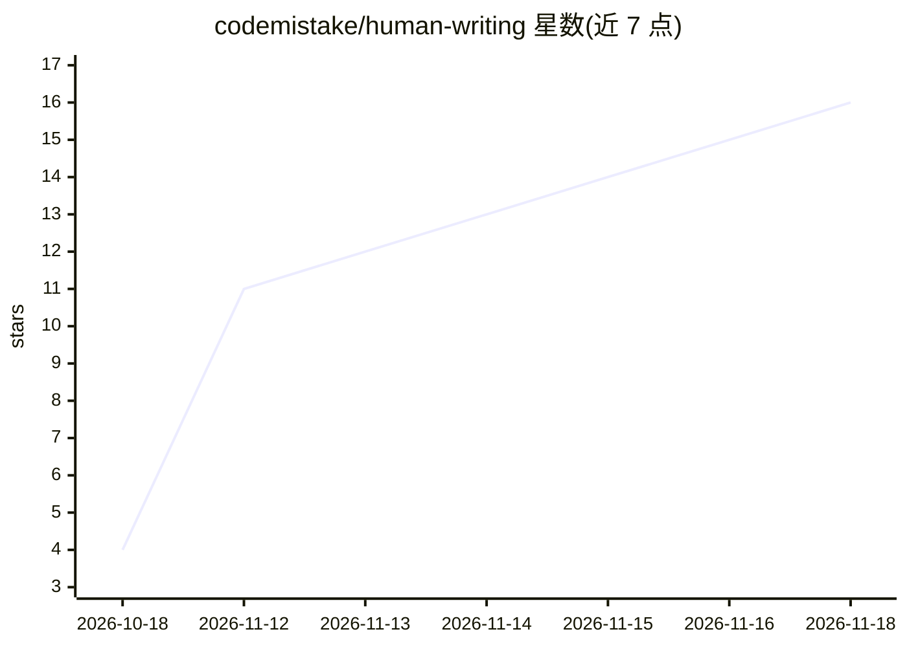

# codemistake/human-writing

⭐ 16 · Python · MIT · 推送 2026-09-10 · [GitHub](https://github.com/codemistake/human-writing) · [官网](https://apexs.tech) · 个人维护 · 中文 README

**面向 AI agent 的俄语优先写作技能，去除 chatbot 腔与官腔**

一个以 Agent Skills 规范（SKILL.md + GLOBAL_RULES.md）形式分发的写作技能：加载进 Claude Code、Codex、Cursor、OpenCode、Claude.ai 等 agent 后，改变 agent 的行文方式——去除官僚俄语、LLM 模板句式、chatbot 习惯用语，保留技术术语与事实内容。俄语规则为主、英语为辅分支；明确不以绕过 AI 检测器为目标，不添加人工错误。通过 npx skills CLI、手动复制或安装脚本安装，附 60 条俄语输入的盲评基准数据。

## 筛选速览

| 维度 | 判定 | 备注 |
|---|---|---|
| AI 角色 | `ai-ecosystem` | LLM/agent 周边工具 |
| 许可风险 | `permissive` | MIT |
| 部署形态 | `library` | 以包/库形式分发 |
| 模型依赖 | — | README 未给出锁定关系 |
| 硬件要求 | — | 无带数字的原话,不猜 |
| 安装摩擦 | `low` | 无编译、无系统依赖或容器化 |
| 成熟度 | — | 结构信号不足 |

## 能力要点

- SKILL.md 全量规则按需加载 + GLOBAL_RULES.md 常驻约 280 词的双层结构
- 俄语优先（含俄语特有 AI 文本特征清单），英语为第二分支
- 明确不做 AI 检测器规避，不添加人为错误
- 提供 60 输入、盲评配对、三 Claude 模型分工的基准数据

## 适用场景

- 让 coding agent 的回复去掉模板腔和官腔
- 让 agent 撰写面向人的文档、README、邮件、release notes
- 在不支持 skills 的平台将规则作为 system prompt 注入

## 场景标签

`AI 写作` `提示工程` · 领域:Agent 开发

## 证据(README 行号)

> L15: **EN:** A Russian-first Agent Skill that makes agent prose read like competent human writing instead of default LLM
> L19: `human-writing` — writing skill для AI-агентов. Он меняет не содержание ответа, а то, как агент разговаривает с чел
> L114: ├── SKILL.md                 # полные правила, загружаются по требованию

## 星数曲线

2026-10-18 4 → 2026-11-18 16（+12）

---
*卡片 v1 · prompt 1.4 · 生成 2026-11-18 · 置信度 high · 依据 README sha `3db82426e037` · [字段定义](../../DATASET.md)*
