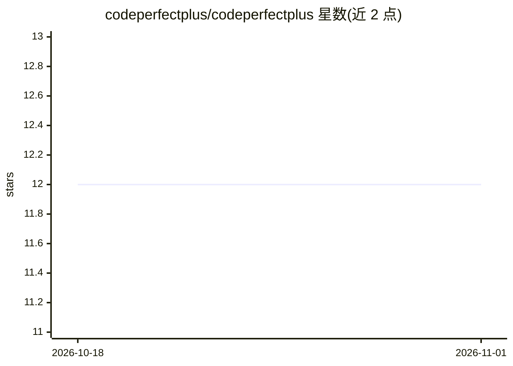

# codeperfectplus/codeperfectplus

⭐ 12 · MIT · 推送 2026-04-25 · [GitHub](https://github.com/codeperfectplus/codeperfectplus) · 个人维护

**开发者个人 GitHub 主页 README：展示项目、技术栈与经历**

Deepak（codeperfectplus）的个人档案页：以代码块形式自我介绍（Scry AI 高级软件工程师，6 年 AI 平台开发经验），列出个人成就、黑客松经历与所维护项目，包括 Sanatio 数据校验、QuickDB 键值存储、Transmeet 会议转录（Groq + Google APIs）、SystemGuard 服务器监控等，另附计划中项目（TensorFlow 人脸/语音认证）与技术栈（LangChain、HuggingFace、OpenAI、Groq）。这是档案页而非可安装软件，仓库本身不提供运行方式。

## 筛选速览

| 维度 | 判定 | 备注 |
|---|---|---|
| AI 角色 | `ai-knowledge` | 知识聚合/清单类 |
| 许可风险 | `permissive` | MIT |
| 部署形态 | `library` | 以包/库形式分发 |
| 模型依赖 | — | README 未给出锁定关系 |
| 硬件要求 | — | 无带数字的原话,不猜 |
| 安装摩擦 | `low` | 无编译、无系统依赖或容器化 |
| 成熟度 | — | 结构信号不足 |

## 能力要点

- 列出十余个个人维护的开源项目及各自 pip 安装命令
- Transmeet 项目使用 Groq + Google APIs 做会议转录与摘要
- 技术栈声明包含 LangChain、HuggingFace、OpenAI、Groq
- 计划中项目含 TensorFlow 人脸/语音认证与统一 ML/DL 指标工具包

## 适用场景

- 了解该开发者的项目列表与技术背景
- 通过 pip 安装其列出的独立项目（Sanatio、QuickDB 等）
- 查看其联系方式与开源贡献记录

## 场景标签

 · 领域:开发者个人主页

## 证据(README 行号)

> L10: *Senior Software Engineer · AI Builder · Open Source Poet*
> L42: > I believe in shipping, not just building. Here's what I maintain:

## 星数曲线

2026-10-18 12 → 2026-11-01 12（+0）

---
*卡片 v1 · prompt 1.4 · 生成 2026-11-01 · 置信度 low · 依据 README sha `5840d310b049` · [字段定义](../../DATASET.md)*
