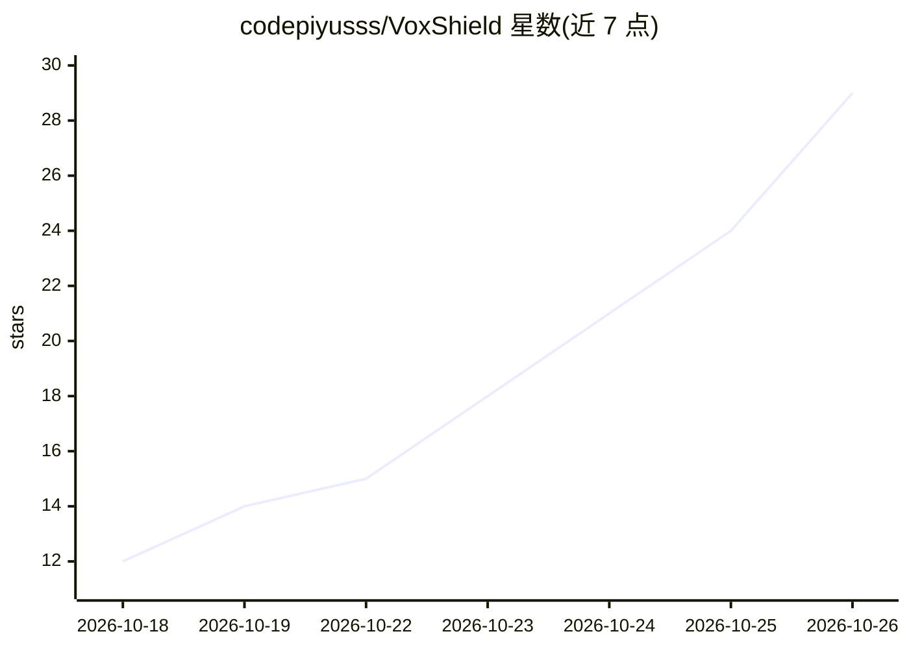

# codepiyusss/VoxShield

⭐ 29 · JavaScript · MIT · 推送 2026-09-28 · [GitHub](https://github.com/codepiyusss/VoxShield) · [官网](https://voxshield-psi.vercel.app) · 个人维护

**检测音频是否为合成语音的机器学习原型系统**

面向语音克隆冒充攻击场景的研究与教育原型：从录音中提取 MFCC、Mel 频谱、谱特征、音高、ZCR、Chroma、RMS 等手工声学特征（方案共 191 维），用 Scikit-learn 监督分类器（候选为随机森林/梯度提升）将音频判为 REAL 或 FAKE。技术栈为 React 前端 + Flask 后端，支持上传音频与浏览器麦克风录音，前端部署在 Vercel。README 明确声明预测不应作为语音真实性的最终证据，且不拦截或监控真实电话通话；训练数据侧重印度口音/印度说话人音频。

## 筛选速览

| 维度 | 判定 | 备注 |
|---|---|---|
| AI 角色 | `ai-native` | 本体是模型或模型工具 |
| 许可风险 | `permissive` | MIT |
| 部署形态 | `None` |  |
| 模型依赖 | — | README 未给出锁定关系 |
| 硬件要求 | — | 无带数字的原话,不猜 |
| 安装摩擦 | `low` | 无编译、无系统依赖或容器化 |
| 成熟度 | `idea` | |

## 能力要点

- 191 维手工声学特征（MFCC、Mel 频谱、谱特征、音高、ZCR、Chroma、RMS）
- Scikit-learn 监督二分类（REAL/FAKE），候选算法为 Random Forest 与 Gradient Boosting
- React + Flask Web 界面，支持上传音频与浏览器麦克风录音
- 提供在线演示站点（Vercel 部署）

## 适用场景

- 上传录音获得真伪分类结果用于演示
- 学习音频特征工程与监督分类的完整流程
- 研究录音条件与数据集构成对合成语音检测的影响

## 场景标签

`网络安全` · 领域:学习与行业

## 证据(README 行号)

> L13: The system extracts acoustic and spectral features from audio recordings and uses supervised machine learning to cl
> L17: > VoxShield is a research and educational prototype. Its predictions should not be treated as definitive proof of v

## 星数曲线

2026-10-18 12 → 2026-10-26 29（+17）

---
*卡片 v1 · prompt 1.4 · 生成 2026-10-26 · 置信度 high · 依据 README sha `c1c52b90fba8` · [字段定义](../../DATASET.md)*
