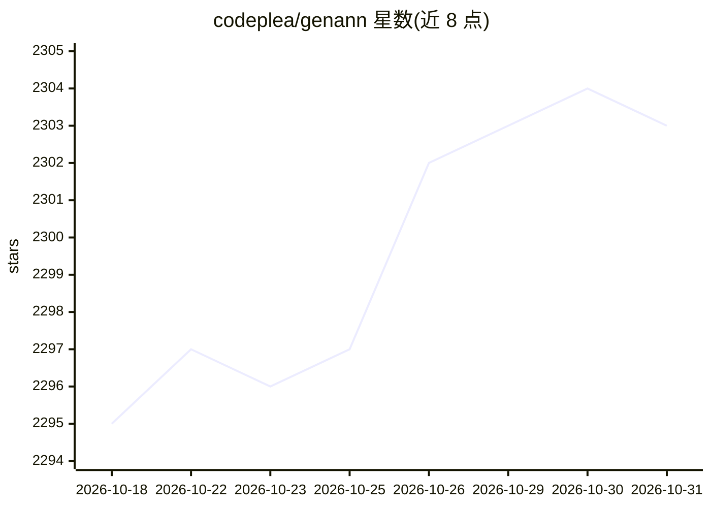

# codeplea/genann

⭐ 2,303 · C · Zlib · 推送 2026-08-08 · [GitHub](https://github.com/codeplea/genann) · [官网](https://codeplea.com/genann) · 个人维护

**面向 C 开发者的单文件前馈神经网络库**

Genann 是用 C99 编写的极简前馈人工神经网络库，全部代码仅含 genann.c 与 genann.h 两个文件，无任何依赖。提供网络的创建、复制、释放、反向传播训练、文本格式存取与前向推理 API，默认 sigmoid 激活，可切换 tanh/relu/linear/threshold。权重存储在连续内存块中，便于配合爬山、遗传算法、模拟退火等直接搜索方法训练。附带四个示例（XOR、IRIS 数据集等）与测试套件，采用 zlib 许可。

## 筛选速览

| 维度 | 判定 | 备注 |
|---|---|---|
| AI 角色 | `ai-native` | 本体是模型或模型工具 |
| 许可风险 | `viral` | Zlib |
| 部署形态 | `None` |  |
| 模型依赖 | — | README 未给出锁定关系 |
| 硬件要求 | — | 无带数字的原话,不猜 |
| 安装摩擦 | `low` | 无编译、无系统依赖或容器化 |
| 成熟度 | — | 结构信号不足 |

## 能力要点

- C99 单文件实现，无依赖，直接加入项目即可使用
- 实现反向传播训练，另兼容遗传算法等直接搜索训练方法
- 权重存储于连续内存块，暴露 total_weights 与 weight 成员
- 支持 sigmoid/tanh/relu/linear/threshold 激活函数切换

## 适用场景

- 在 C 项目中嵌入轻量级前馈神经网络训练与推理
- 用遗传算法等非梯度方法优化网络权重
- 学习神经网络底层实现并按需修改源码

## 场景标签

 · 领域:机器学习/软件库

## 证据(README 行号)

> L8: Genann is a minimal, well-tested library for training and using feedforward
> L20: - Implements backpropagation training.

## 星数曲线

2026-10-18 2,295 → 2026-10-31 2,303（+8）

---
*卡片 v1 · prompt 1.4 · 生成 2026-10-21 · 置信度 high · 依据 README sha `e756f421078c` · [字段定义](../../DATASET.md)*
