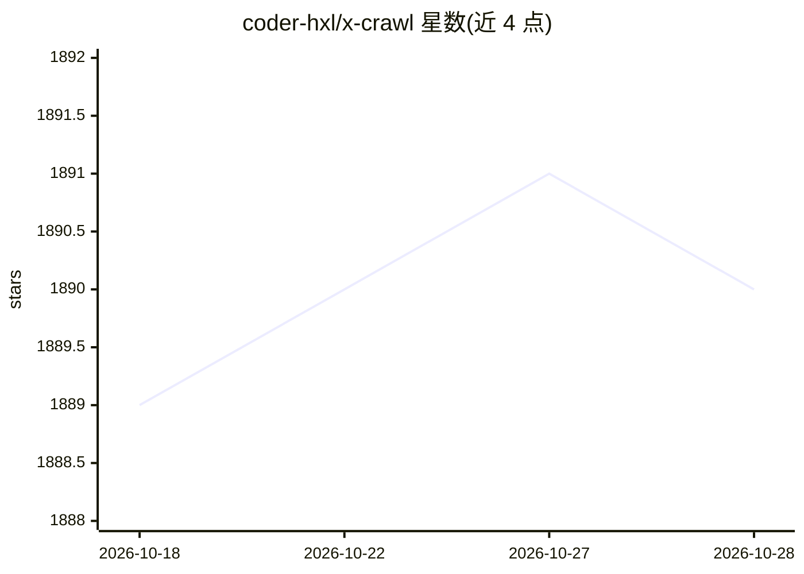

# coder-hxl/x-crawl

⭐ 1,890 · TypeScript · MIT · 推送 2026-10-27 · [GitHub](https://github.com/coder-hxl/x-crawl) · [官网](https://coder-hxl.github.io/x-crawl/) · 个人维护 · 中文 README

**Node.js 爬虫库，可结合 AI 解析网页提取数据**

面向 JavaScript/TypeScript 开发者的灵活爬虫库，由两部分组成：爬虫 API 支持动态/静态页面、接口数据与文件数据抓取，具备设备指纹、失败重试、轮换代理、优先队列、异步/同步模式等能力，且无需 AI 也能正常工作；AI 部分集成 ollama 和 openai，可让 AI 按自然语言指令理解并解析 HTML 语义以提取数据，应对类名或结构变更。以 npm 库形式提供，TypeScript 类型完备，MIT 许可。

## 筛选速览

| 维度 | 判定 | 备注 |
|---|---|---|
| AI 角色 | `ai-enhanced` | 去掉 AI 部分产品仍成立 |
| 许可风险 | `permissive` | MIT |
| 部署形态 | `None` |  |
| 模型依赖 | local-ok | 支持本地模型 |
| 硬件要求 | — | 无带数字的原话,不猜 |
| 安装摩擦 | `low` | 无编译、无系统依赖或容器化 |
| 成熟度 | — | 结构信号不足 |

## 能力要点

- 单一爬虫 API 支持多种配置与动态/静态页面、接口与文件抓取
- 集成 ollama 和 openai，AI 按指令解析 HTML 语义提取数据
- 设备指纹、失败重试、轮换代理、优先队列、间隔爬取等控制能力
- TypeScript 编写并自带完整泛型类型

## 适用场景

- 抓取动态或静态页面、接口数据与文件资源
- 网站结构变更后仍需稳定提取数据的场景
- 通过自然语言指令让 AI 定位并提取页面内容

## 场景标签

`网页抓取` · 领域:效率与自动化

## 证据(README 行号)

> L9: - Crawler: It consists of a crawler API and various functions that can work normally even without relying on AI.
> L10: - AI: Integrate ollama and openai, AI simplifies many tedious operations.

## 星数曲线

2026-10-18 1,889 → 2026-10-28 1,890（+1）

---
*卡片 v1 · prompt 1.4 · 生成 2026-10-21 · 置信度 high · 依据 README sha `31adae8b4712` · [字段定义](../../DATASET.md)*
