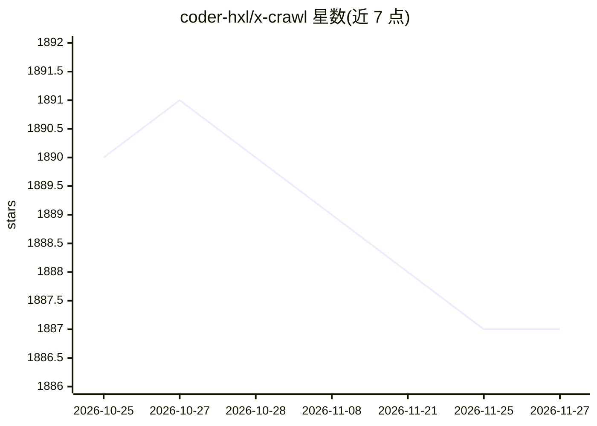

# coder-hxl/x-crawl

⭐ 1,887 · TypeScript · MIT · 推送 2026-11-25 · [GitHub](https://github.com/coder-hxl/x-crawl) · [官网](https://coder-hxl.github.io/x-crawl/) · 个人维护 · 中文 README

**Node.js AI 辅助爬虫库：用 AI 应对网页结构变化**

一个 Node.js 爬虫库，由两部分组成：不依赖 AI 也可正常工作的爬虫 API，以及集成的 AI 辅助功能。爬虫部分支持动态页面、静态页面、接口数据与文件数据抓取，提供设备指纹配置、异步/同步模式、间隔抓取、失败重试、代理轮换、优先队列与 TypeScript 类型。AI 部分集成 ollama 与 openai，通过语义理解网页内容来提取数据，减少对固定 class 名或结构的依赖，从而在网站更新后仍可正常抓取。通过 npm 安装，文档提供英文与简体中文版本。

## 筛选速览

| 维度 | 判定 | 备注 |
|---|---|---|
| AI 角色 | `ai-enhanced` | 去掉 AI 部分产品仍成立 |
| 许可风险 | `permissive` | MIT |
| 部署形态 | `None` |  |
| 模型依赖 | local-ok | 支持本地模型 |
| 硬件要求 | — | 无带数字的原话,不猜 |
| 安装摩擦 | `low` | 无编译、无系统依赖或容器化 |
| 成熟度 | — | 结构信号不足 |

## 能力要点

- 单个爬取 API 适用多种配置，支持异步/同步模式切换
- 集成 ollama 与 openai，由 AI 解析网页语义提取数据
- 支持动态/静态页面、接口与文件数据抓取
- 零配置或自定义设备指纹配置

## 适用场景

- 抓取页面结构经常变动的网站数据
- 按自然语言指令从网页中提取指定内容
- 需要代理轮换、失败重试与并发控制的批量抓取

## 场景标签

`网页抓取` · 领域:效率与自动化

## 证据(README 行号)

> L9: - Crawler: It consists of a crawler API and various functions that can work normally even without relying on AI.
> L10: - AI: Integrate ollama and openai, AI simplifies many tedious operations.

## 星数曲线

2026-10-25 1,890 → 2026-11-27 1,887（-3）

---
*卡片 v1 · prompt 1.4 · 生成 2026-11-23 · 置信度 high · 依据 README sha `296f964e962d` · [字段定义](../../DATASET.md)*
