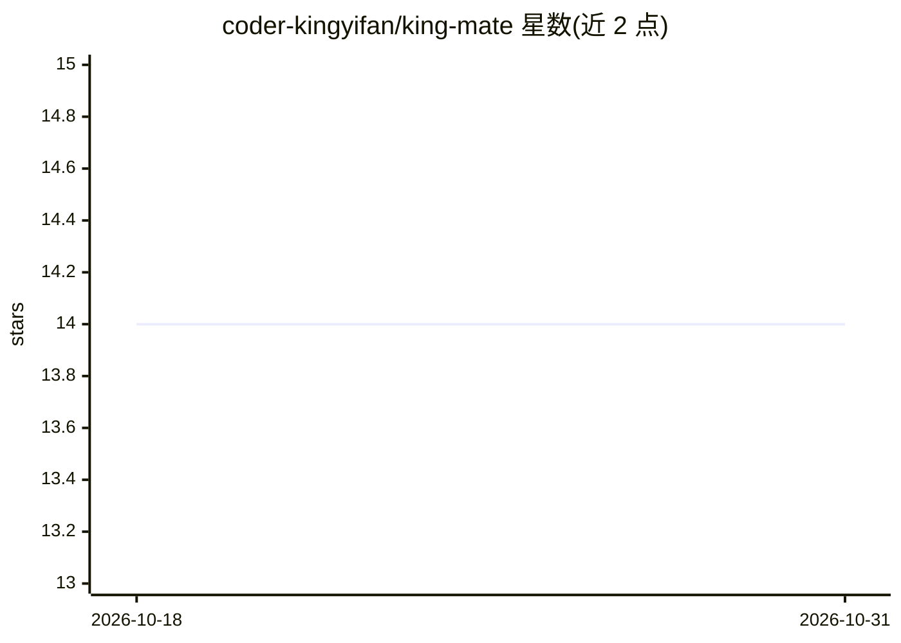

# coder-kingyifan/king-mate

⭐ 14 · Vue · NOASSERTION · 推送 2026-05-11 · [GitHub](https://github.com/coder-kingyifan/king-mate) · [官网](https://coder-kingyifan.github.io/king-about-mate/) · 个人维护 · 中文 README

**本地桌面效率助手：日历/待办/会议 + AI 对话与多渠道通知**

基于 Electron + Vue 3 的开源桌面应用，把日历总览、日程（循环/农历/节假日模式）、待办、会议记录与多渠道通知收进单一工作流，本地 SQLite 存储并可选 AES-256-GCM 加密。AI 作为可开关的功能模块存在：自然语言创建事项、会议摘要、图片识别、技能调用（API/提示词/联网搜索），接入 OpenAI、DeepSeek、Claude、Ollama 等十余家模型服务商。另提供本地 HTTP API、Docker Headless 部署与微信 ClawBot 机器人通道。许可证为 CC BY-NC-SA 4.0，含非商业限制。

## 筛选速览

| 维度 | 判定 | 备注 |
|---|---|---|
| AI 角色 | `ai-enhanced` | 去掉 AI 部分产品仍成立 |
| 许可风险 | `none` | NOASSERTION |
| 部署形态 | `desktop` | 安装包/桌面程序 |
| 模型依赖 | local-ok | 支持本地模型 |
| 硬件要求 | — | 无带数字的原话,不猜 |
| 安装摩擦 | `low` | 无编译、无系统依赖或容器化 |
| 成熟度 | — | 结构信号不足 |

## 能力要点

- 日程支持农历换算、中国法定节假日工作日/节假日模式
- 接入 14 家 AI 服务商（含 Ollama 本地部署）与自定义 OpenAI/Anthropic 兼容接口
- 12 类通知渠道（桌面/邮件/Telegram/微信 ClawBot/钉钉/飞书等）
- 技能系统含内置技能、自定义技能与社区技能商店
- 本地数据库可选 AES-256-GCM 加密，密钥分离存储

## 适用场景

- 把日程、待办、会议和通知集中在一个桌面应用里管理
- 通过自然语言或微信消息让 AI 创建和管理事项
- 在服务器上以 Docker Headless 模式运行并通过 API/通知渠道使用
- 把天气、倒计时等技能绑定到定时事项，触发时推送动态内容

## 场景标签

`AI 助手` · 领域:对话与助手

## 证据(README 行号)

> L78: 工作、生活、会议、临时想法和各种通知常常散落在不同地方。King Mate 希望把这些入口收拢到一个本地桌面应用里：日历总览、日程事项、待办清单、会议记录、AI
> L132: 内置 AI 助手，支持自然语言创建和管理日程、待办、技能，也可以作为日常对话入口。
> L221: - **应用模式** — 支持 AI 模式和普通模式，按使用习惯隐藏或展示 AI 相关入口

## 星数曲线

2026-10-18 14 → 2026-10-31 14（+0）

---
*卡片 v1 · prompt 1.4 · 生成 2026-10-31 · 置信度 high · 依据 README sha `90c572fa8cad` · [字段定义](../../DATASET.md)*
