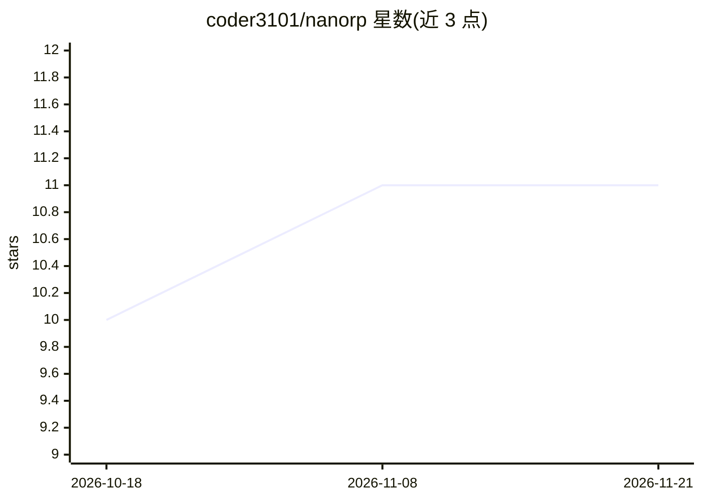

# coder3101/nanorp

⭐ 11 · Rust · MIT · 推送 2026-09-21 · [GitHub](https://github.com/coder3101/nanorp) · 个人维护

**自托管 AI 角色扮演聊天系统：本地数据、接入自有模型**

单二进制自托管的 AI 角色扮演聊天服务，用 Rust（Axum 服务端 + Leptos/WASM 前端）构建，状态存于编译进二进制的 SQLite 文件，无 Node/Python/数据库服务器依赖。用户创建角色（含从文本描述用模型生成角色配置），在设置中添加 Ollama 或 OpenAI 兼容端点作为模型来源，支持流式输出、图像附件、推理块展示、消息编辑后重生成。提供 Docker/Compose 部署，发布 amd64/arm64 镜像。

## 筛选速览

| 维度 | 判定 | 备注 |
|---|---|---|
| AI 角色 | `ai-native` | 本体是模型或模型工具 |
| 许可风险 | `permissive` | MIT |
| 部署形态 | `self-host` | docker 或自建部署 |
| 模型依赖 | local-ok | 支持本地模型 |
| 硬件要求 | — | 无带数字的原话,不猜 |
| 安装摩擦 | `low` | 无编译、无系统依赖或容器化 |
| 成熟度 | — | 结构信号不足 |

## 能力要点

- 单静态二进制 + 内嵌 SQLite，无数据库服务器与 JS 运行时
- 接入 Ollama 与任意 OpenAI 兼容端点，可配置多 Provider 并中途切换模型
- 角色系统含占位符模板与从文本描述生成角色 JSON
- 流式输出、推理块、图像附件（每条消息最多 5 张）

## 适用场景

- 在自己机器或树莓派/VPS 上搭建角色扮演聊天
- 连接本地 Ollama 模型进行离线对话
- 导入导出 JSON 管理多个角色配置

## 场景标签

`聊天机器人` · 领域:对话与助手

## 证据(README 行号)

> L5: **A lightweight, self-hosted AI roleplay chat.**
> L72: 1. Open **Settings → Providers** and add one:
> L94: - Token-by-token streaming, with stop-and-cancel that reaches the provider

## 星数曲线

2026-10-18 10 → 2026-11-21 11（+1）

---
*卡片 v1 · prompt 1.4 · 生成 2026-11-18 · 置信度 high · 依据 README sha `38eac92a12a3` · [字段定义](../../DATASET.md)*
