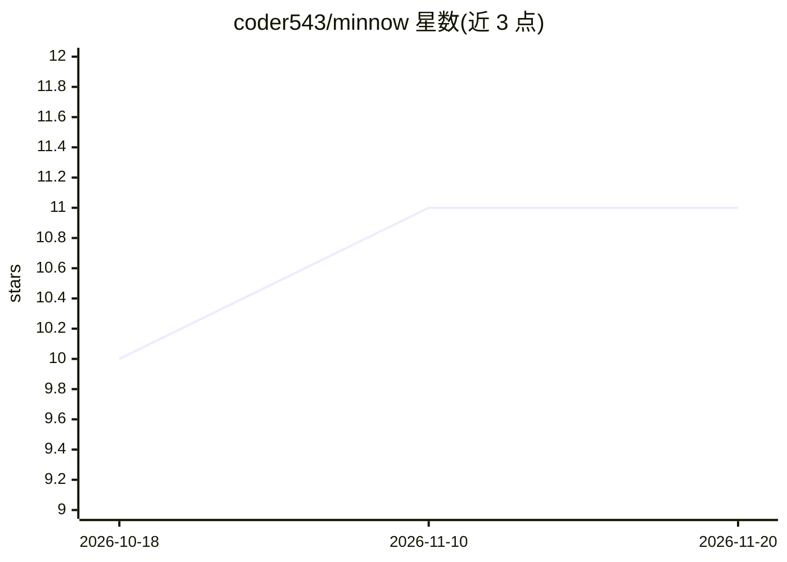

# coder543/minnow

⭐ 11 · Rust · Apache-2.0 · 推送 2026-09-09 · [GitHub](https://github.com/coder543/minnow) · 个人维护

**为 LLaDA2.2 模型提供 Rust 推理服务器，支持 OpenAI 兼容 API**

Minnow 是用 Rust 编写的 LLaDA2.2-mini 与 LLaDA2.2-flash 推理服务器，支持 OpenAI Chat Completions、流式输出、工具调用、对话前缀缓存、连续批处理，并可选挂载 llama-server 的 Web UI。它缓存已提交的 32-token 块、仅重算当前块以加速扩散式生成；提供 BF16/INT8/INT4/NVFP4 量化格式的 .mnw 检查点下载与自建转换工具，可在 CUDA 或 CPU 上运行，并附带各精度在 DGX Spark 与 RTX 3090 上的吞吐测量数据。

## 筛选速览

| 维度 | 判定 | 备注 |
|---|---|---|
| AI 角色 | `ai-ecosystem` | LLM/agent 周边工具 |
| 许可风险 | `permissive` | Apache-2.0 |
| 部署形态 | `None` |  |
| 模型依赖 | — | README 未给出锁定关系 |
| 硬件要求 | `cpu-ok` | |
| 安装摩擦 | `high` | 编译与系统依赖俱全 |
| 成熟度 | — | 结构信号不足 |

## 能力要点

- OpenAI Chat Completions 兼容 API，支持流式、工具调用与前缀缓存
- 提供 INT8/INT4/NVFP4 量化检查点下载与自建转换工具，无需 Python
- 块级 FlashAttention 与仅重算当前块的缓存机制
- CPU 路径与 CUDA 路径共享同一 API 与缓存行为

## 适用场景

- 在 NVIDIA GPU 上部署 LLaDA2.2 扩散语言模型并提供 API 服务
- 在 24 GiB 显存的消费级 GPU 上以量化精度运行模型
- 为已有 OpenAI 客户端的应用接入 LLaDA 推理后端

## 场景标签

`推理引擎` `模型量化` · 领域:训练与推理

## 证据(README 行号)

> L3: Minnow is a Rust inference server for **LLaDA2.2-mini and LLaDA2.2-flash**. It
> L4: supports OpenAI Chat Completions, streaming, tool calling, conversation prefix
> L107: `--device auto` (the default) selects CUDA when available, otherwise CPU.

## 星数曲线

2026-10-18 10 → 2026-11-20 11（+1）

---
*卡片 v1 · prompt 1.4 · 生成 2026-11-18 · 置信度 high · 依据 README sha `3472596e242c` · [字段定义](../../DATASET.md)*
