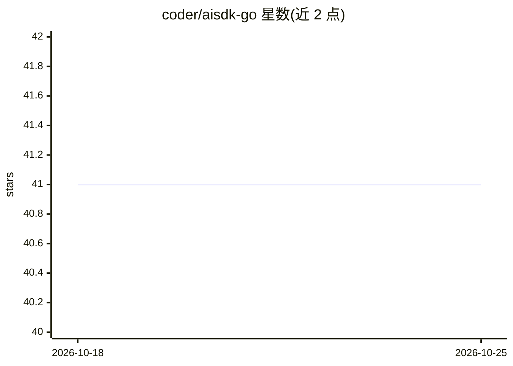

# coder/aisdk-go

⭐ 41 · Go · MIT · 推送 2025-11-20 · [GitHub](https://github.com/coder/aisdk-go) · 组织维护

**Go 实现 Vercel AI SDK 数据流协议的后端库**

用 Go 实现 Vercel AI SDK Data Stream Protocol，使前端 useChat 可直接指向 Go 后端。支持 OpenAI、Google、Anthropic（含 Bedrock 通道），提供 useChat 集成示例，并支持类似 maxSteps 的链式工具调用。以 Go 库形式提供，开发时通过 go test 运行测试，示例需设置各模型 API key。README 自述库处于早期阶段、可能大幅变更。

## 筛选速览

| 维度 | 判定 | 备注 |
|---|---|---|
| AI 角色 | `ai-ecosystem` | LLM/agent 周边工具 |
| 许可风险 | `permissive` | MIT |
| 部署形态 | `None` |  |
| 模型依赖 | locked-api |  |
| 硬件要求 | — | 无带数字的原话,不猜 |
| 安装摩擦 | `low` | 无编译、无系统依赖或容器化 |
| 成熟度 | `idea` | |

## 能力要点

- Go 实现 Vercel AI SDK Data Stream Protocol
- 支持 OpenAI、Google、Anthropic（含 Bedrock）
- 链式工具调用，类似 maxSteps
- 提供 useChat 前后端集成示例

## 适用场景

- 用 Go 编写对接 useChat 的聊天后端
- 在 Go 服务中流式返回 AI 回复与工具调用
- 将 Vercel AI SDK 前端切换到自建 Go 后端

## 场景标签

`Agent 框架` · 领域:Agent 开发

## 证据(README 行号)

> L10: A Go implementation of Vercel's AI SDK Data Stream Protocol.
> L12: - Supports OpenAI, Google, and Anthropic (with Bedrock support)

## 星数曲线

2026-10-18 41 → 2026-10-25 41（+0）

---
*卡片 v1 · prompt 1.4 · 生成 2026-10-25 · 置信度 high · 依据 README sha `85867e4c65d0` · [字段定义](../../DATASET.md)*
