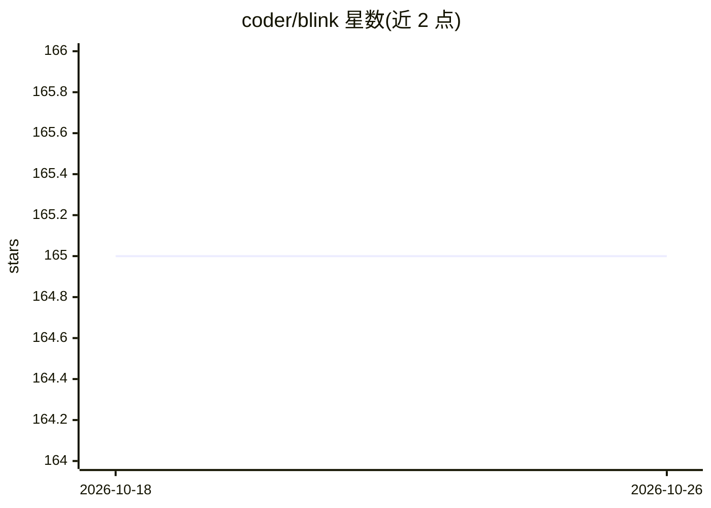

# coder/blink

⭐ 165 · TypeScript · AGPL-3.0 · 推送 2026-10-23 · [GitHub](https://github.com/coder/blink) · [官网](https://blink.coder.com/docs) · 组织维护

**自托管平台：构建并通过 Slack/GitHub/Web 运行团队 AI agent**

自托管的 AI agent 构建与运行平台：Blink Server 将 agent 以 Docker 容器部署，路由来自 Slack、GitHub 与 Web UI 的消息并管理会话状态。内置面向编码任务与代码库研究的 Scout agent，可用 Blink SDK（TypeScript）自定义工具与提示或构建新 agent，另提供 CLI 与 Web UI（对话、日志与 trace、用户/组织管理）。agent 可接入任意 LLM 提供商。注意：README 声明项目已不再积极维护，且仍处早期访问阶段。需 Node.js 22+/Bun 与 Docker。

## 筛选速览

| 维度 | 判定 | 备注 |
|---|---|---|
| AI 角色 | `ai-ecosystem` | LLM/agent 周边工具 |
| 许可风险 | `viral` | AGPL-3.0 |
| 部署形态 | `library` | 以包/库形式分发 |
| 模型依赖 | — | README 未给出锁定关系 |
| 硬件要求 | — | 无带数字的原话,不猜 |
| 安装摩擦 | `low` | 无编译、无系统依赖或容器化 |
| 成熟度 | `idea` | |

## 能力要点

- 内置可定制的 Scout agent，面向编码任务与代码库研究
- Blink SDK 用 TypeScript 构建 agent，agent 为响应事件的 HTTP 服务，以 Docker 容器部署
- Slack、GitHub、Web UI 多入口消息路由与会话状态管理
- Web UI 提供对话、日志与 trace 可观测性及用户/组织管理

## 适用场景

- 在 Slack 中让 agent 解答复杂代码库的问题
- 在共享 Slack 频道中为客户提供基于代码库与文档引用的技术支持
- 团队自托管运行自定义 AI agent 并集中管理访问控制

## 场景标签

`Agent 框架` `编码 Agent` · 领域:Agent 开发

## 证据(README 行号)

> L15: Blink is a self-hosted platform for running AI agents that your team can talk to in Slack, GitHub, and a web UI.
> L58: - **Blink SDK** - a set of libraries for building agents compatible with the Blink platform

## 星数曲线

2026-10-18 165 → 2026-10-26 165（+0）

---
*卡片 v1 · prompt 1.4 · 生成 2026-10-22 · 置信度 high · 依据 README sha `d1e234aad9e8` · [字段定义](../../DATASET.md)*
