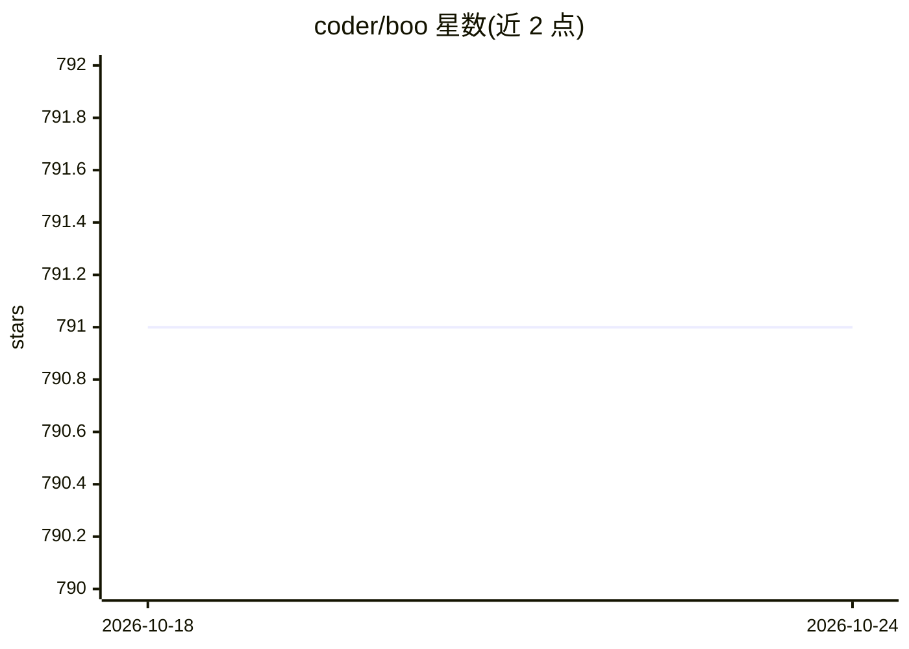

# coder/boo

⭐ 790 · Zig · MIT · 推送 2026-07-05 · [GitHub](https://github.com/coder/boo) · 组织维护

**GNU screen 风格的终端复用器，供脚本与 AI agent 驱动终端**

基于 libghostty-vt（Ghostty 终端仿真核心）、用 Zig 编写的终端复用器。每个会话的输出经终端仿真核心解析，保存完整屏幕状态（内容、样式、光标、回滚），重连时重建屏幕，分离状态下也可响应终端查询。提供 send/peek/wait 命令与 JSON 输出，除 attach 外均无需 TTY，供脚本和 AI agent 驱动交互式程序。已声明为早期项目，单会话单窗口、无分屏，前缀键不可配置。

## 筛选速览

| 维度 | 判定 | 备注 |
|---|---|---|
| AI 角色 | `ai-ecosystem` | LLM/agent 周边工具 |
| 许可风险 | `permissive` | MIT |
| 部署形态 | `desktop` | 安装包/桌面程序 |
| 模型依赖 | — | README 未给出锁定关系 |
| 硬件要求 | — | 无带数字的原话,不猜 |
| 安装摩擦 | `low` | 无编译、无系统依赖或容器化 |
| 成熟度 | `idea` | |

## 能力要点

- 会话断开后存活，attach 时从 libghostty 状态重建屏幕
- send/peek/wait 与 --json 输出，无需 TTY 即可自动化
- 分离状态下由 libghostty 响应终端查询（DSR/DA/XTWINOPS 等）
- 预编译二进制发布，curl 脚本一键安装（Linux/macOS）

## 适用场景

- 在服务器上保持会话，断线后重连恢复终端现场
- 让脚本或 AI agent 无 TTY 驱动交互式程序并读取屏幕
- 用 wait --text/--idle 替代 sleep 轮询等待程序输出

## 场景标签

 · 领域:终端/开发者工具

## 证据(README 行号)

> L18: A GNU `screen` style terminal multiplexer built on
> L80: Everything except `attach` works without a terminal, which makes boo a
> L81: natural sandbox for scripts and AI agents driving interactive programs.

## 星数曲线

2026-10-18 791 → 2026-10-24 791（+0）

---
*卡片 v1 · prompt 1.4 · 生成 2026-10-21 · 置信度 high · 依据 README sha `dfc6ae4967c9` · [字段定义](../../DATASET.md)*
