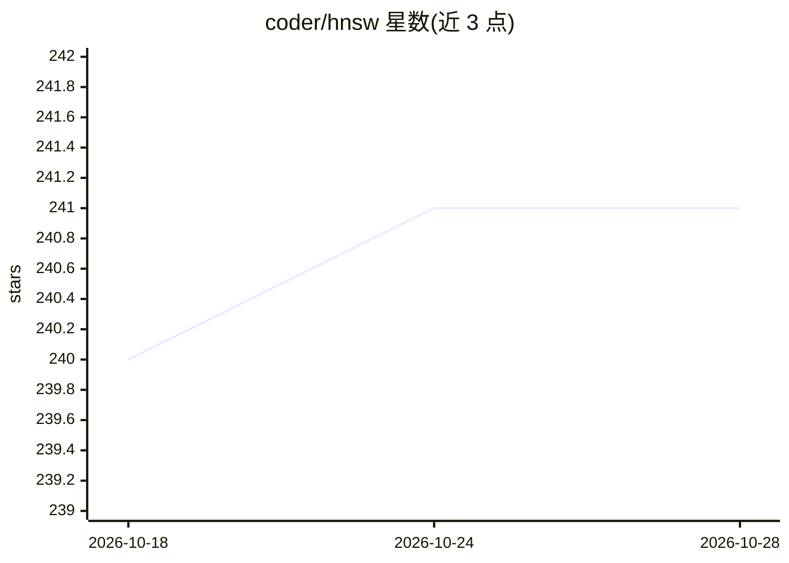

# coder/hnsw

⭐ 241 · Go · CC0-1.0 · 推送 2026-06-22 · [GitHub](https://github.com/coder/hnsw) · 组织维护

**Go 语言的内存态 HNSW 向量索引库**

用 Go 实现 Hierarchical Navigable Small World 图，为高维向量提供内存中的近似最近邻搜索。操作覆盖 Insert/Delete/Search/Lookup 四项核心操作，各自给出近似复杂度。定位为内存态向量数据库（如 Pinecone、Weaviate）的替代方案，提供二进制编码的图导入/导出与单文件 SavedGraph 读写。README 给出内存开销公式与调参（维度、M、m_L）对性能和内存影响的说明。以 Go 包形式通过 go get 安装。

## 筛选速览

| 维度 | 判定 | 备注 |
|---|---|---|
| AI 角色 | `ai-ecosystem` | LLM/agent 周边工具 |
| 许可风险 | `viral` | CC0-1.0 |
| 部署形态 | `None` |  |
| 模型依赖 | — | README 未给出锁定关系 |
| 硬件要求 | — | 无带数字的原话,不猜 |
| 安装摩擦 | `low` | 无编译、无系统依赖或容器化 |
| 成熟度 | — | 结构信号不足 |

## 能力要点

- Insert/Delete/Search/Lookup 四项核心操作及近似复杂度标注
- Graph.Export/Import 与 SavedGraph 支持持久化加载/保存
- 提供内存开销公式与维度/M/m_L 调参指引
- 二进制编码使保存/加载接近磁盘速度

## 适用场景

- Go 服务中做高维向量的近似最近邻检索
- 不想部署独立向量数据库时的内存态向量索引方案
- 需要把向量图持久化到单文件后重新加载

## 场景标签

`向量数据库` · 领域:知识与检索

## 证据(README 行号)

> L5: Package `hnsw` implements Hierarchical Navigable Small World graphs in Go. You
> L10: This package can be thought of as an in-memory alternative to your favorite

## 星数曲线

2026-10-18 240 → 2026-10-28 241（+1）

---
*卡片 v1 · prompt 1.4 · 生成 2026-10-22 · 置信度 high · 依据 README sha `692cb8e56367` · [字段定义](../../DATASET.md)*
