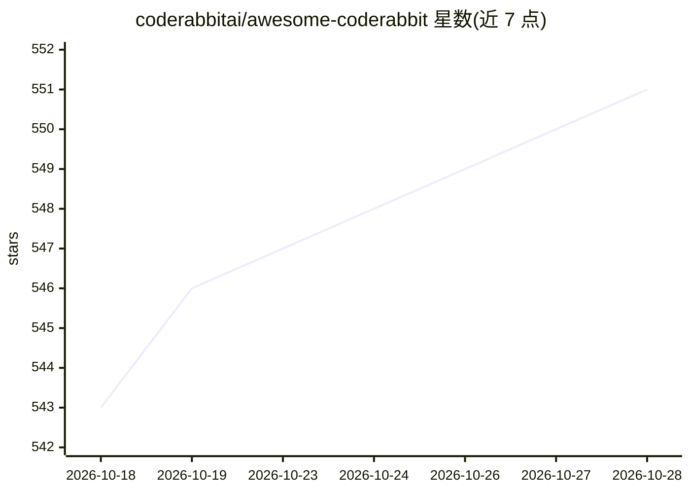

# coderabbitai/awesome-coderabbit

⭐ 551 · CC0-1.0 · 推送 2026-09-29 · [GitHub](https://github.com/coderabbitai/awesome-coderabbit) · [官网](https://www.coderabbit.ai/) · 组织维护

**CodeRabbit AI 代码审查工具的官方资源策展清单**

由 CodeRabbit 官方维护的 awesome-list，聚合与 CodeRabbit（AI 代码审查工具）相关的资源：官方文档/博客/FAQ、REST API 的 OpenAPI 文档、按语言组织的 YAML 配置示例（configs/ 目录，覆盖 JavaScript/TypeScript/Python/Go/多语言）、预合并检查策略包、Azure DevOps 与 CI/CD 等集成指南、视频教程、博客与媒体报道，以及 13 个使用该工具的开源项目示例。面向评估或上手 CodeRabbit 的开发团队与开发者。

## 筛选速览

| 维度 | 判定 | 备注 |
|---|---|---|
| AI 角色 | `ai-knowledge` | 知识聚合/清单类 |
| 许可风险 | `viral` | CC0-1.0 |
| 部署形态 | `None` |  |
| 模型依赖 | — | README 未给出锁定关系 |
| 硬件要求 | — | 无带数字的原话,不猜 |
| 安装摩擦 | `low` | 无编译、无系统依赖或容器化 |
| 成熟度 | — | 结构信号不足 |

## 能力要点

- 按 5 类语言组织的 CodeRabbit 配置示例目录
- 预合并检查策略包，覆盖多租户 SaaS、金融科技、健康科技场景
- Azure DevOps/CI/CD/Linear 等集成指南
- 13 个使用该工具的开源项目示例清单

## 适用场景

- 查找 CodeRabbit 的配置示例并按项目语言选用
- 为 CI/CD 流水线接入 AI 代码审查查找集成指南
- 了解哪些开源项目在生产中使用该工具

## 场景标签

`精选清单` · 领域:学习与行业

## 证据(README 行号)

> L1: # Awesome CodeRabbit Awesome
> L5: This curated list covers the best resources, tutorials, and community content related to CodeRabbit 🐰

## 星数曲线

2026-10-18 543 → 2026-10-28 551（+8）

---
*卡片 v1 · prompt 1.4 · 生成 2026-10-21 · 置信度 high · 依据 README sha `1add0af43e67` · [字段定义](../../DATASET.md)*
