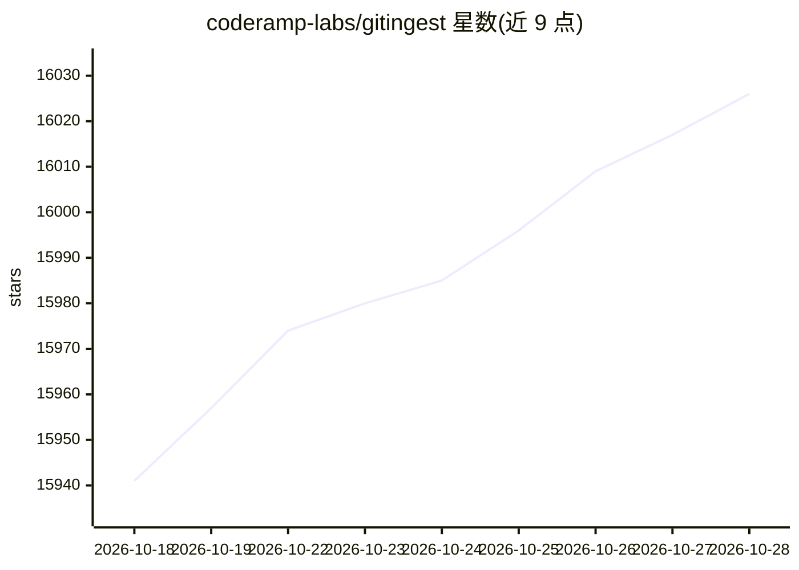

# coderamp-labs/gitingest

⭐ 16,040 · Python · MIT · 推送 2026-10-28 · [GitHub](https://github.com/coderamp-labs/gitingest) · [官网](https://gitingest.com) · 组织维护 · 中文 README

**把 Git 仓库转成 LLM 可用文本摘要的开发者工具**

将任意 Git 仓库 URL 或本地目录转换为面向 LLM 提示词优化的文本摘要，输出文件/目录结构、提取大小与 token 统计（基于 tiktoken 估算）。提供三种使用途径：网页版（改 GitHub URL 中的 hub 为 ingest）、CLI 命令行工具与 Python 包（同步/异步 API，兼容 Jupyter）。默认跳过 .gitignore 文件，私有仓库需 GitHub PAT。支持 Docker/Compose 自托管服务端，可选 MinIO S3 存储、Prometheus 指标与 Sentry 错误跟踪。

## 筛选速览

| 维度 | 判定 | 备注 |
|---|---|---|
| AI 角色 | `ai-ecosystem` | LLM/agent 周边工具 |
| 许可风险 | `permissive` | MIT |
| 部署形态 | `self-host` | docker 或自建部署 |
| 模型依赖 | — | README 未给出锁定关系 |
| 硬件要求 | — | 无带数字的原话,不猜 |
| 安装摩擦 | `low` | 无编译、无系统依赖或容器化 |
| 成熟度 | — | 结构信号不足 |

## 动量与使用信号

- 维护:`active` — 距上次 push 1.2 天,年发版 0,54 位贡献者
- 涨星:近 1 天 **+9**(自 20261016 起算)
- 安装:pypi 包 `gitingest` 月下载 163,295

## 能力要点

- CLI、Python 包（含 sync/async API）与浏览器扩展三种使用方式
- 输出文件结构、提取大小与 token 统计（tiktoken 估算）
- 默认跳过 .gitignore，可用 --include-gitignored 覆盖，支持 STDOUT 管道输出
- Docker Compose 提供 prod/dev 两套 profile，dev 集成 MinIO 对象存储

## 适用场景

- 把代码库内容喂给 LLM 做分析或问答前先提取上下文
- 命令行里把仓库摘要直接管道给其他工具处理
- 在 Jupyter notebook 中异步提取仓库内容做代码研究
- 自托管一个仓库摘要网页服务供团队使用

## 场景标签

`文档解析` · 领域:知识与检索

## 证据(README 行号)

> L20: Turn any Git repository into a prompt-friendly text ingest for LLMs.
> L37: - **Easy code context**: Get a text digest from a Git repository URL or a directory
> L43: - **CLI tool**: Run it as a shell command
> L44: - **Python package**: Import it in your code

## 星数曲线

2026-10-18 15,941 → 2026-10-28 16,026（+85）

---
*卡片 v1 · prompt 1.4 · 生成 2026-10-18 · 置信度 high · 依据 README sha `28025cf72069` · [字段定义](../../DATASET.md)*
