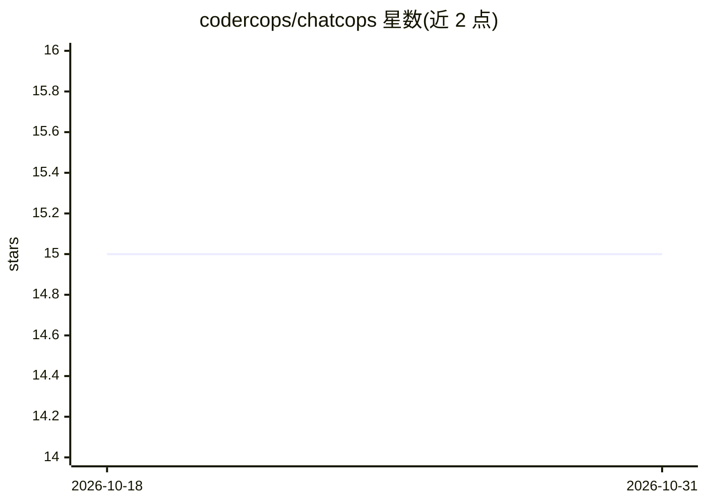

# codercops/chatcops

⭐ 15 · TypeScript · MIT · 推送 2026-10-30 · [GitHub](https://github.com/codercops/chatcops) · [官网](https://chat.codercops.com) · 组织维护

**网站可嵌入的通用 AI 聊天挂件，一行 script 接入多模型**

以单个 script 标签向任意网站添加 AI 助手挂件的产品，分三个 npm 包：widget（零依赖 Shadow DOM 挂件，约 13KB gzip）、core（多模型抽象、工具、知识库、i18n）、server（Express/Vercel/Cloudflare Workers 适配器）。支持 Claude/OpenAI/Gemini 切换、SSE 流式输出、线索收集、知识库、会话持久化与分析。面向需要在自有网站部署 AI 对话能力的开发者与站点运营者，MIT 许可。

## 筛选速览

| 维度 | 判定 | 备注 |
|---|---|---|
| AI 角色 | `ai-native` | 本体是模型或模型工具 |
| 许可风险 | `permissive` | MIT |
| 部署形态 | `library` | 以包/库形式分发 |
| 模型依赖 | locked-api |  |
| 硬件要求 | — | 无带数字的原话,不猜 |
| 安装摩擦 | `low` | 无编译、无系统依赖或容器化 |
| 成熟度 | — | 结构信号不足 |

## 能力要点

- 单个 script 标签嵌入，Shadow DOM 隔离，约 13KB gzip
- Claude/OpenAI/Gemini 多模型，一次配置切换
- 内置线索收集（webhook）、知识库（文本块/FAQ）
- 提供 Express、Vercel、Cloudflare Workers 三种服务端适配器

## 适用场景

- 给公司官网添加 AI 客服/助手挂件
- 在网站对话中收集访客联系方式并推送 webhook
- 基于自有 FAQ/文本资料构建上下文相关回答

## 场景标签

`聊天机器人` · 领域:对话与助手

## 证据(README 行号)

> L9: Universal, embeddable AI chatbot widget. Add an AI assistant to any website with a single `<script>` tag.
> L42: - **Multi-provider** - Claude, OpenAI, Gemini. Switch with one config change.

## 星数曲线

2026-10-18 15 → 2026-10-31 15（+0）

---
*卡片 v1 · prompt 1.4 · 生成 2026-10-30 · 置信度 high · 依据 README sha `6a57591aba8a` · [字段定义](../../DATASET.md)*
