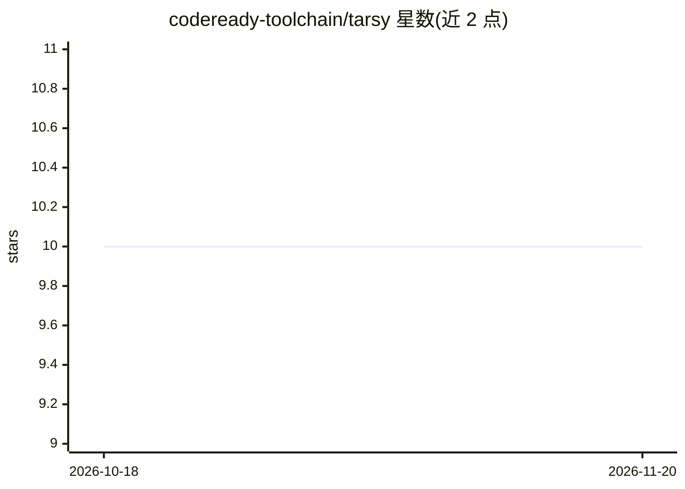

# codeready-toolchain/tarsy

⭐ 10 · Go · Apache-2.0 · 推送 2026-11-18 · [GitHub](https://github.com/codeready-toolchain/tarsy) · 组织维护

**面向 SRE 的告警自动处理 agent 系统：多阶段调查与分析**

TARSy（Thoughtful Alert Response System）接收来自监控系统的告警，通过并行 agent 链执行多阶段事件调查并输出分析结论与建议。Go 编排器负责会话管理与实时流式处理，无状态 Python 服务经 gRPC 处理 LLM 调用；agent 通过 MCP 服务器获取 kubectl、数据库客户端等领域工具，支持 YAML 配置定义 agent、子 agent 动态编排、供应商回退、SKILL.md 技能加载、会话评分、跨会话记忆（pgvector 检索）与人工分诊流程。原 Python 实现已弃用，本仓库为其 Go 混合重写版。

## 筛选速览

| 维度 | 判定 | 备注 |
|---|---|---|
| AI 角色 | `ai-native` | 本体是模型或模型工具 |
| 许可风险 | `permissive` | Apache-2.0 |
| 部署形态 | `None` |  |
| 模型依赖 | — | README 未给出锁定关系 |
| 硬件要求 | — | 无带数字的原话,不猜 |
| 安装摩擦 | `low` | 无编译、无系统依赖或容器化 |
| 成熟度 | — | 结构信号不足 |

## 能力要点

- 基于 YAML 配置部署 agent 与链定义，支持并行执行与 A/B 比较
- 通过 MCP 服务器动态连接领域工具（kubectl、数据库客户端、监控 API）
- 自动供应商回退列表与按模型的用量/估算成本统计
- 会话评分、Reflector 记忆提取与人工分诊工作流

## 适用场景

- 自动处理监控系统告警并生成调查分析报告
- 为 SRE 团队提供告警分诊与事后复盘流程
- 运维知识沉淀为 SKILL.md 技能与跨会话记忆供 agent 复用

## 场景标签

`工作流自动化` `Agent 框架` · 领域:Agent 开发

## 证据(README 行号)

> L6: **TARSy** (Thoughtful Alert Response System) is an intelligent SRE system that automatically processes alerts throug
> L68: - **Multi-LLM Provider Support**: OpenAI, Google Gemini, Anthropic, xAI, Vertex AI -- configure and switch via YAML

## 星数曲线

2026-10-18 10 → 2026-11-20 10（+0）

---
*卡片 v1 · prompt 1.4 · 生成 2026-11-19 · 置信度 high · 依据 README sha `727cf482ec5d` · [字段定义](../../DATASET.md)*
