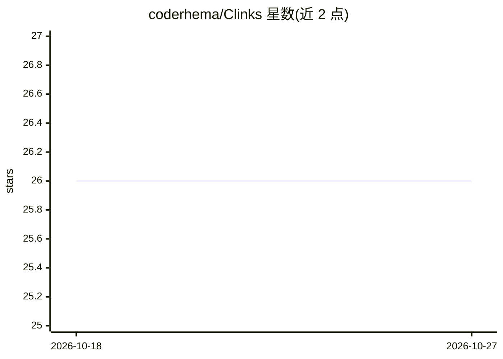

# coderhema/Clinks

⭐ 26 · TypeScript · 推送 2026-05-14 · [GitHub](https://github.com/coderhema/Clinks) · [官网](https://clinksai.vercel.app) · 个人维护

**用自然语言搭建并执行生成式媒体工作流的节点画布**

基于 Web 的可视化节点工作流构建器：用户对 AI 助手用自然语言下达指令，AI 自动创建节点、按顺序连接并布局在画布上，可生成图像、视频、Logo、音频与文本，支持实时执行与多阶段流水线。AI 助手基于 Tambo API（需免费 API key），以 Next.js/pnpm 项目形式提供，git clone 源码运行，另有可选 Docker 构建。

## 筛选速览

| 维度 | 判定 | 备注 |
|---|---|---|
| AI 角色 | `ai-native` | 本体是模型或模型工具 |
| 许可风险 | `none` | — |
| 部署形态 | `self-host` | docker 或自建部署 |
| 模型依赖 | — | README 未给出锁定关系 |
| 硬件要求 | — | 无带数字的原话,不猜 |
| 安装摩擦 | `low` | 无编译、无系统依赖或容器化 |
| 成熟度 | — | 结构信号不足 |

## 能力要点

- 自然语言命令自动创建、连接与布局工作流节点
- 多模态生成：图像、视频、Logo、音频、文本
- 可视化拖拽画布与实时执行
- 多阶段流水线可串联多个 AI 操作

## 适用场景

- 用一句话让 AI 搭建文生图或视频生成工作流
- 通过节点画布设计并实时执行生成式媒体流水线
- 快速生成 Logo 与音效等创意素材

## 场景标签

`工作流自动化` `图像生成` `视频生成` · 领域:效率与自动化

## 证据(README 行号)

> L5: Clinks lets you create complex generative media workflows using natural language. Just tell the AI what you want to 
> L11: - ⚡ **Multi-Modal Generation** - Images, videos, logos, audio, and text

## 星数曲线

2026-10-18 26 → 2026-10-27 26（+0）

---
*卡片 v1 · prompt 1.4 · 生成 2026-10-26 · 置信度 high · 依据 README sha `466440e5d77f` · [字段定义](../../DATASET.md)*
