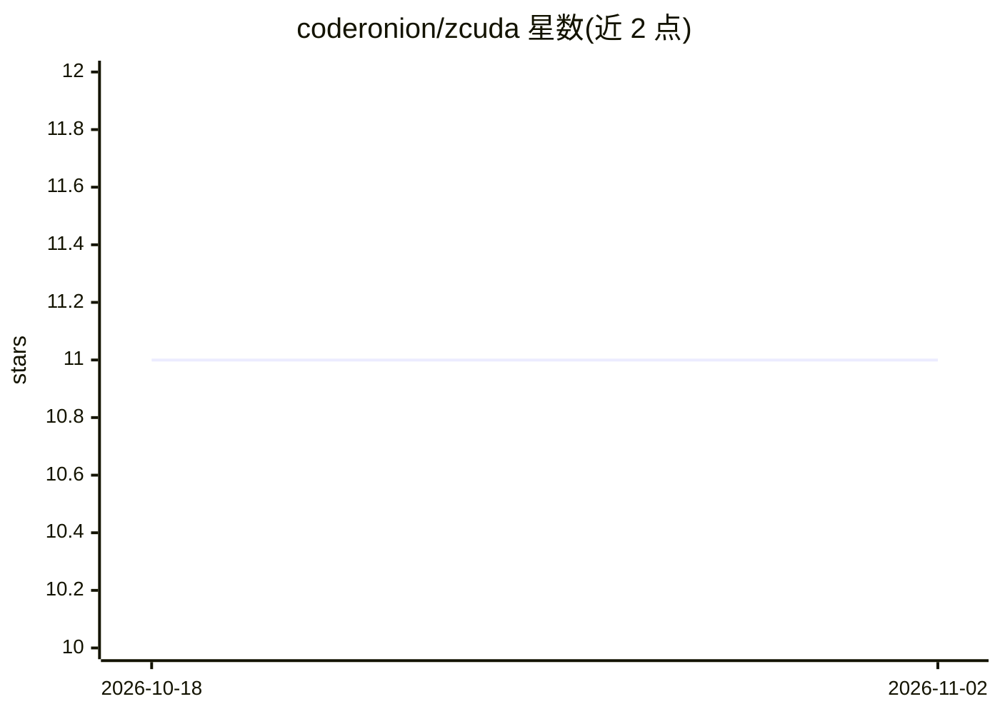

# coderonion/zcuda

⭐ 11 · Zig · MIT · 推送 2026-02-22 · [GitHub](https://github.com/coderonion/zcuda) · 个人维护

**Zig 的 CUDA 双生态框架：绑定层 + 纯 Zig 内核 DSL**

面向 GPU 开发者的双生态框架：一是为 11 个 CUDA C++ 库（driver、cuBLAS、cuDNN、cuFFT、cuSOLVER 等）提供类型安全的 Zig 绑定，可经 NVRTC JIT 或预编译 PTX 调用既有 C++ 内核；二是 zcuda_kernel DSL，在构建期把纯 Zig 编译为 PTX，无需 nvcc，支持 Tensor Core 与全套设备端内建函数，两种内核经同一 stream.launch() API 启动。以 Zig 包（build.zig.zon）或源码方式使用。前置要求：特定版本 Zig 0.16.0-dev、CUDA Toolkit 12.x、Compute Capability 7.0+ 的 NVIDIA GPU；已在 RTX 3080 Ti（sm_86）上通过全部测试与示例。

## 筛选速览

| 维度 | 判定 | 备注 |
|---|---|---|
| AI 角色 | `ai-ecosystem` | LLM/agent 周边工具 |
| 许可风险 | `permissive` | MIT |
| 部署形态 | `None` |  |
| 模型依赖 | — | README 未给出锁定关系 |
| 硬件要求 | — | 无带数字的原话,不猜 |
| 安装摩擦 | `medium` | 含编译或系统依赖之一 |
| 成熟度 | — | 结构信号不足 |

## 能力要点

- 11 个 CUDA 库的类型安全 Zig 绑定（driver/cuBLAS/cuDNN/cuFFT/cuSOLVER/cuSPARSE/cuRAND/NVRTC/NVTX/CUPTI）
- 纯 Zig 内核 DSL 在构建期直接编译为 PTX，无需 nvcc
- C++ 与 Zig 内核可混合使用，同一 stream.launch() API 启动
- 支持 Tensor Core（WMMA/MMA，f16/bf16/tf32/int8/fp8）与跨平台交叉编译

## 适用场景

- 在纯 Zig 工具链中编写和编译 CUDA GPU 内核
- 从 Zig 项目复用现有 CUDA C++ 内核（NVRTC JIT 或 PTX 加载）
- 构建依赖 cuBLAS/cuDNN 等 CUDA 库的 Zig GPU 应用

## 场景标签

 · 领域:GPU 编程/异构计算库

## 证据(README 行号)

> L7: - 🔗 **CUDA Binding Layer** — Complete, type-safe Zig bindings for CUDA C++ libraries (driver API, cuBLAS, cuDNN, cuF
> L8: - ⚡ **CUDA Kernel DSL** — A zero-overhead device-side API (`zcuda_kernel`) that compiles pure Zig directly to PTX at

## 星数曲线

2026-10-18 11 → 2026-11-02 11（+0）

---
*卡片 v1 · prompt 1.4 · 生成 2026-11-02 · 置信度 mid · 依据 README sha `e9e36a2e1e9c` · [字段定义](../../DATASET.md)*
