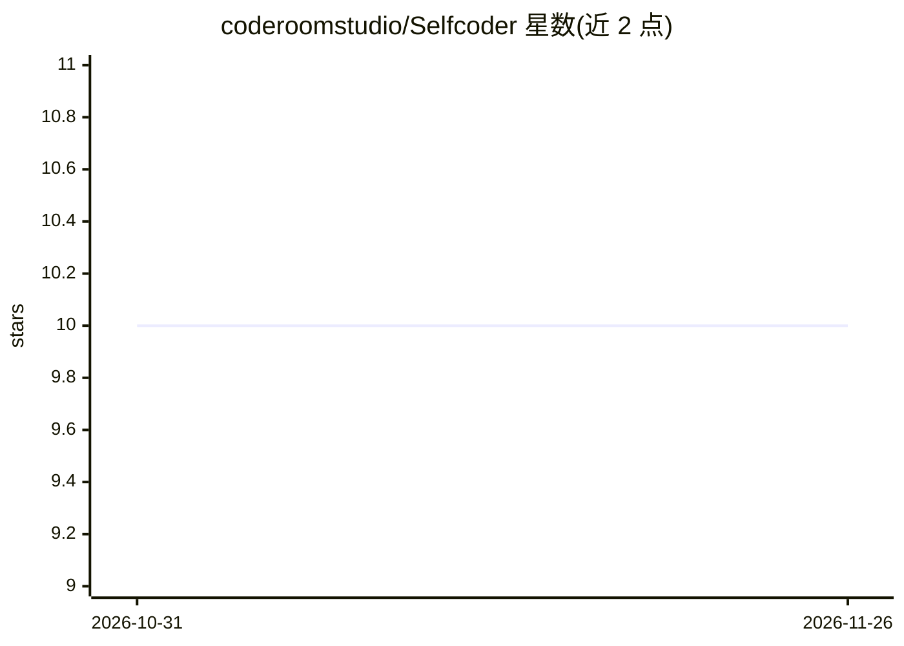

# coderoomstudio/Selfcoder

⭐ 10 · 推送 2026-11-03 · [GitHub](https://github.com/coderoomstudio/Selfcoder) · [官网](https://selfcoder.dev/) · 组织维护

**面向开发者的本地模型 VS Code 编码助手扩展**

一个 VS Code 扩展，将聊天、Plan 模式与 Agent 模式编码工作流接入 Visual Studio Code，后端连接 LM Studio、Ollama、vLLM、llama.cpp 等 OpenAI 兼容服务器，模型由用户按硬件选择。功能包括聊天面板、代码库调查的 Plan 模式、带权限控制与回滚的 Agent 模式、本地 FIM 模型驱动的行内补全、编辑器右键菜单（解释/修复/测试/文档/重构）与 Fix 快捷修复。本仓库为文档与问题追踪主页，本体从 VS Code Marketplace 安装，要求 VS Code 1.106+。

## 筛选速览

| 维度 | 判定 | 备注 |
|---|---|---|
| AI 角色 | `ai-ecosystem` | LLM/agent 周边工具 |
| 许可风险 | `none` | — |
| 部署形态 | `None` |  |
| 模型依赖 | local-ok | 支持本地模型 |
| 硬件要求 | — | 无带数字的原话,不猜 |
| 安装摩擦 | `low` | 无编译、无系统依赖或容器化 |
| 成熟度 | — | 结构信号不足 |

## 能力要点

- Chat/Plan/Agent 三模式，权限递进且共享会话上下文
- 连接 LM Studio、Ollama、vLLM、llama.cpp 等 OpenAI 兼容后端
- 本地 FIM 模型行内补全，补全与聊天模型分离
- 复用 OpenCode、Claude Code、Codex、Copilot、Cursor、Gemini 的 skills 与 workspace agents

## 适用场景

- 在 VS Code 中用本地部署的模型进行代码聊天与解释
- 让 Agent 模式按权限实现并验证较大的工作区任务
- 用本地小模型做行内代码补全，大模型处理聊天

## 场景标签

`编码 Agent` `代码生成` · 领域:编码与开发

## 证据(README 行号)

> L3: **A self-hosted AI coding assistant for VS Code that works with LM Studio, Ollama, vLLM, llama.cpp, and more.**
> L5: Selfcoder brings chat, planning, and autonomous coding workflows into Visual Studio Code. Connect LM Studio, Ollama,
> L20: Selfcoder connects to models served by **LM Studio**, **Ollama**, **vLLM**, **llama.cpp**, and other OpenAI-compati

## 星数曲线

2026-10-31 10 → 2026-11-26 10（+0）

---
*卡片 v1 · prompt 1.4 · 生成 2026-11-19 · 置信度 high · 依据 README sha `4f5c2bfa4f62` · [字段定义](../../DATASET.md)*
