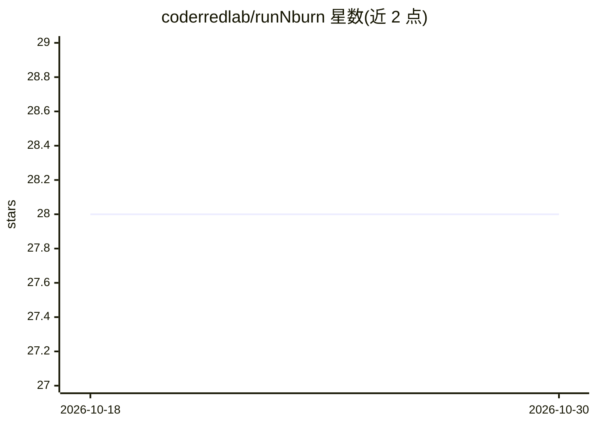

# coderredlab/runNburn

⭐ 28 · Rust · Apache-2.0 · 推送 2026-08-27 · [GitHub](https://github.com/coderredlab/runNburn) · 个人维护

**内存受限硬件上直跑 GGUF 量化模型的 Rust 推理运行时**

Rust 编写的 GGUF 量化模型卸载推理运行时：权重保持 file-backed mmap，按检测到的 RAM/VRAM 控制驻留与缓存，不生成转换副本或 sidecar。后端含 CPU（Linux/macOS/Android ARM64）、CUDA、Metal（Vulkan/OpenCL 实验性）。提供 CLI、交互式 chat、OpenAI 兼容 HTTP 服务（/v1/responses、chat/completions，支持多模态、工具、结构化输出）与 Android C ABI。明确面向个人单所有者消费级硬件服务器，连续批处理与多租户为非目标。pre-1.0 状态，加速路径仍在演进。

## 筛选速览

| 维度 | 判定 | 备注 |
|---|---|---|
| AI 角色 | `ai-ecosystem` | LLM/agent 周边工具 |
| 许可风险 | `permissive` | Apache-2.0 |
| 部署形态 | `library` | 以包/库形式分发 |
| 模型依赖 | — | README 未给出锁定关系 |
| 硬件要求 | — | 无带数字的原话,不猜 |
| 安装摩擦 | `high` | 编译与系统依赖俱全 |
| 成熟度 | `idea` | |

## 能力要点

- GGUF 权重直接 mmap 执行，按内存预算控制卸载驻留
- OpenAI 兼容服务：Responses/Chat Completions、SSE 流式、多模态与结构化输出
- 覆盖 CPU/CUDA/Metal/Android ARM64，Q2_K–Q6_K 等原生量化内核
- KV/SSM 序列状态保留与前缀复用（continuation）

## 适用场景

- 在内存小于模型体积的消费级设备上运行量化大模型
- 本地起一个 OpenAI 兼容端点供现有客户端接入
- Android 应用通过 C ABI 集成设备端推理

## 场景标签

`推理引擎` · 领域:训练与推理

## 证据(README 行号)

> L24: runNburn is a general Rust offloading runtime for quantized GGUF models too
> L154: Each server process loads one GGUF model and serializes inference through a bounded worker queue. Start it with:
> L59: |**One product contract**|The CLI, Rust API, Android C ABI, and OpenAI-compatible server share model-loading and me

## 星数曲线

2026-10-18 28 → 2026-10-30 28（+0）

---
*卡片 v1 · prompt 1.4 · 生成 2026-10-26 · 置信度 high · 依据 README sha `5497b0c80bd2` · [字段定义](../../DATASET.md)*
