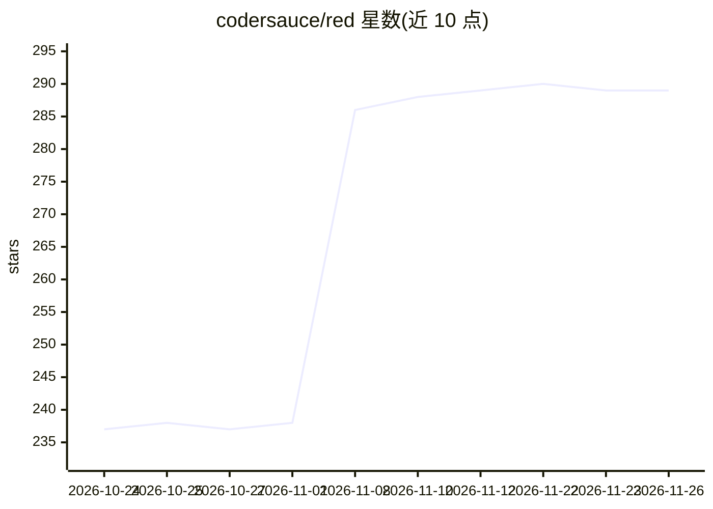

# codersauce/red

⭐ 289 · Rust · MIT · 推送 2026-11-15 · [GitHub](https://github.com/codersauce/red) · [官网](https://rededitor.app) · 个人维护

**Vim 风格终端代码编辑器：让 Codex agent 在编辑器内工作**

用 Rust 编写的终端模态编辑器，单个自包含二进制，开箱即用无需配置。编辑部分提供 Vim 模式/动作/操作符兼容、Tree-sitter 语法高亮、LSP 支持、模糊文件搜索、Git 工作区、插件与主题系统、可分离会话与崩溃恢复。AI 部分为可选功能：需安装并登录 Codex CLI（0.144.1+），agent 通过编辑器事务读写文件，支持带编辑器上下文的 Agent 工作区与针对选区/函数的内联审查、解释、重构，内联编辑以未保存、可撤销的事务形式呈现。安装覆盖 Homebrew、Nix、Scoop、DEB/RPM 及安装脚本，支持自动更新。

## 筛选速览

| 维度 | 判定 | 备注 |
|---|---|---|
| AI 角色 | `ai-enhanced` | 去掉 AI 部分产品仍成立 |
| 许可风险 | `permissive` | MIT |
| 部署形态 | `None` |  |
| 模型依赖 | — | README 未给出锁定关系 |
| 硬件要求 | — | 无带数字的原话,不猜 |
| 安装摩擦 | `low` | 无编译、无系统依赖或容器化 |
| 成熟度 | — | 结构信号不足 |

## 能力要点

- Vim 模态编辑兼容契约（versioned behavior contract）+ Tree-sitter 高亮与内置 LSP 默认配置
- Codex agent 仅通过编辑器工具读写文件，编辑经过事务与保存路径并落盘
- 内联辅助（Space i）针对选区或封闭函数，改动为未保存可撤销事务
- 原生 Git 工作区（暂存/提交/分支/rebase）与 macOS/Linux 可分离会话

## 适用场景

- 在终端里用 Vim 操作习惯编辑代码并获得 LSP/语法高亮
- 让 Codex agent 基于打开缓冲区、未保存改动与诊断进行代码修改
- 在 SSH 断开后恢复编辑会话与运行中的 agent
- 用 Markdown 渲染模式阅读表格、链接与图片并同时可编辑源码

## 场景标签

`编码 Agent` · 领域:编码与开发

## 证据(README 行号)

> L10: > The Vim-style terminal editor where your coding agent works through your editor.
> L14: configuration; optional agent support requires an installed, authenticated Codex CLI.
> L115: Agent support is optional. It requires Codex CLI 0.144.1 or newer and a

## 星数曲线

2026-10-24 237 → 2026-11-26 289（+52）

---
*卡片 v1 · prompt 1.4 · 生成 2026-11-25 · 置信度 high · 依据 README sha `9122aaac50d0` · [字段定义](../../DATASET.md)*
