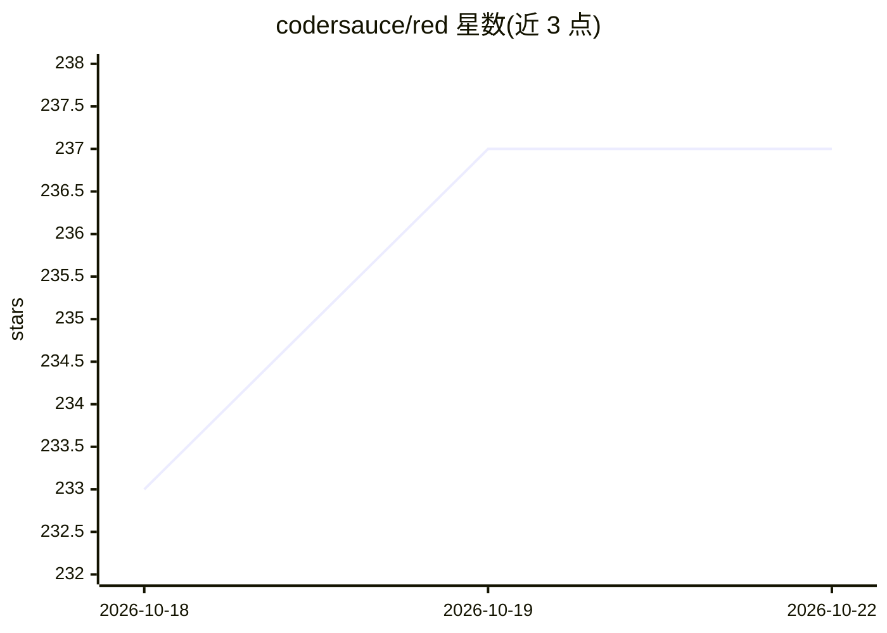

# codersauce/red

⭐ 237 · Rust · MIT · 推送 2026-10-21 · [GitHub](https://github.com/codersauce/red) · [官网](https://rededitor.app) · 个人维护

**Rust 编写的 Vim 风格终端编辑器，可接入 Codex 编码代理**

单文件 Rust 二进制的终端模态编辑器，提供 Vim 模式/操作符、Tree-sitter 高亮、内置多语言 LSP 默认配置、Git 工作区（含 Codex 生成的提交信息）、主题与插件系统（Husk 语言）、可分离会话与崩溃恢复。代理功能可选：需安装并登录 Codex CLI（0.144.1+），代理经编辑器事务读写文件，另有针对选中代码的内联审查/解释/重构。当前为 pre-1.0 早期版本。

## 筛选速览

| 维度 | 判定 | 备注 |
|---|---|---|
| AI 角色 | `ai-enhanced` | 去掉 AI 部分产品仍成立 |
| 许可风险 | `permissive` | MIT |
| 部署形态 | `None` |  |
| 模型依赖 | — | README 未给出锁定关系 |
| 硬件要求 | — | 无带数字的原话,不猜 |
| 安装摩擦 | `low` | 无编译、无系统依赖或容器化 |
| 成熟度 | `idea` | |

## 能力要点

- Codex 代理通过编辑器受限工具读写文件，编辑归属会话并经保存路径落盘
- 内联辅助：对选区或包含函数进行审查/解释/重构，改动未保存且可撤销
- 单二进制内嵌默认配置、主题与插件，开箱无需配置
- macOS/Linux 可分离会话保留 buffers、LSP 状态与运行中的代理

## 适用场景

- 习惯 Vim 操作的开发者在终端完成编辑与代码导航
- 让 Codex 代理在编辑器内读写文件并保持变更可审查
- 在终端内完成 Git 暂存、提交、分支与变基等操作

## 场景标签

`编码 Agent` · 领域:编码与开发

## 证据(README 行号)

> L10: > The Vim-style terminal editor where your coding agent works through your editor.
> L82: Agent support is optional. It requires Codex CLI 0.144.1 or newer and a
> L89: - **Give your agent the real editor.** Codex sees open buffers, unsaved changes,

## 星数曲线

2026-10-18 233 → 2026-10-22 237（+4）

---
*卡片 v1 · prompt 1.4 · 生成 2026-10-22 · 置信度 high · 依据 README sha `7d6723300bd2` · [字段定义](../../DATASET.md)*
