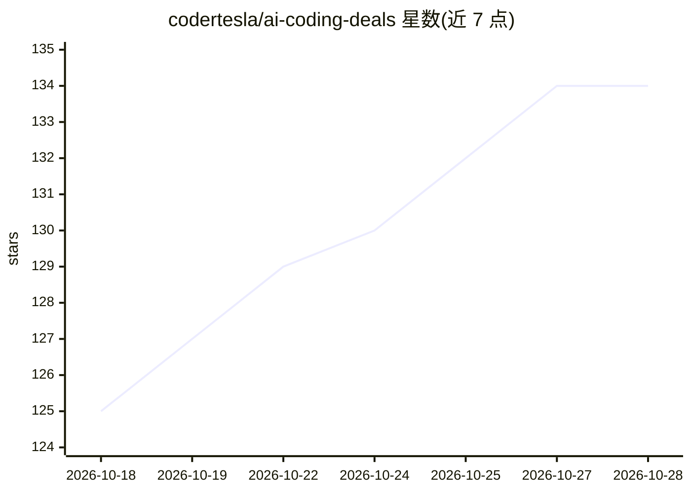

# codertesla/ai-coding-deals

⭐ 134 · Python · MIT · 推送 2026-09-17 · [GitHub](https://github.com/codertesla/ai-coding-deals) · 个人维护 · 中文 README

**AI 编程工具省钱指南：追踪免费额度、折扣与开源替代**

社区维护的 AI 编程工具价格与成本优化清单：汇总各工具的免费层、商业折扣、邀请返利积分与开源替代方案，按主题分类组织（精选优惠、零预算策略、Agentic IDE 对比表等）。条目对照官方文档核验并标注验证状态与截止日期，提供中英双语 README。内容为信息聚合，需在厂商官网二次确认价格与条款。面向希望降低 AI 编程工具支出的开发者与技术团队。

## 筛选速览

| 维度 | 判定 | 备注 |
|---|---|---|
| AI 角色 | `ai-knowledge` | 知识聚合/清单类 |
| 许可风险 | `permissive` | MIT |
| 部署形态 | `library` | 以包/库形式分发 |
| 模型依赖 | — | README 未给出锁定关系 |
| 硬件要求 | — | 无带数字的原话,不猜 |
| 安装摩擦 | `low` | 无编译、无系统依赖或容器化 |
| 成熟度 | — | 结构信号不足 |

## 能力要点

- 按推荐优先级排列的精选优惠表（标注已验证状态）
- 零预算策略章节覆盖免费工具、自托管 BYOK 与厂商免费层
- Agentic IDE 档案含分档价格与折扣/积分信息
- 条目标注最后核验时间并开放 PR 更新

## 适用场景

- 挑选免费或低成本的 AI 编程工具
- 查找 AI 编程订阅的折扣与邀请返利
- 了解自托管开源替代方案与免费推理端点

## 场景标签

`精选清单` · 领域:学习与行业

## 证据(README 行号)

> L3: > A comprehensive guide to AI coding tool selection and cost optimization — tracking free tiers, commercial discount
> L16: AI coding tool pricing and quotas evolve rapidly. This repository tracks **free tiers, commercial discounts, referr

## 星数曲线

2026-10-18 125 → 2026-10-28 134（+9）

---
*卡片 v1 · prompt 1.4 · 生成 2026-10-22 · 置信度 mid · 依据 README sha `39550f3ea173` · [字段定义](../../DATASET.md)*
