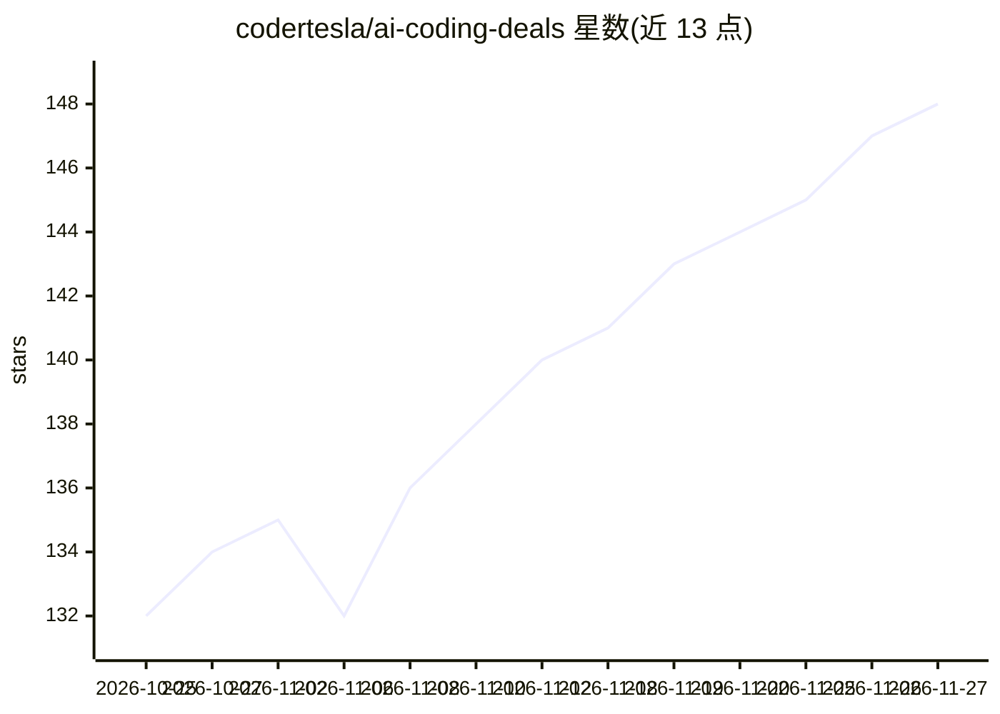

# codertesla/ai-coding-deals

⭐ 148 · Python · MIT · 推送 2026-11-14 · [GitHub](https://github.com/codertesla/ai-coding-deals) · 个人维护 · 中文 README

**AI 编程工具省钱指南：汇总免费额度与折扣**

一份双语的 AI 编程工具定价参考清单，追踪 30+ 款 IDE、CLI Agent 与 LLM API 的订阅档位、免费额度、推荐返利、学生优惠与 BYOK 低价接入路径。内容按免费方案、Agentic IDE、扩展、CLI Agent、促销与学生优惠等类别组织，以表格呈现各工具价格与配额规则，注明依据官方供应商文档核验的时间点，并接受 Pull Request 更新。定位为参考信息汇编，不含代码实现。

## 筛选速览

| 维度 | 判定 | 备注 |
|---|---|---|
| AI 角色 | `ai-knowledge` | 知识聚合/清单类 |
| 许可风险 | `permissive` | MIT |
| 部署形态 | `library` | 以包/库形式分发 |
| 模型依赖 | local-ok | 支持本地模型 |
| 硬件要求 | — | 无带数字的原话,不猜 |
| 安装摩擦 | `low` | 无编译、无系统依赖或容器化 |
| 成熟度 | — | 结构信号不足 |

## 能力要点

- 追踪 30+ 工具的定价、免费额度与返利信息
- 整理 $0 预算的 BYOK / 本地模型组合方案
- 中英双语版本
- 标注核验日期并欢迎 PR 更新

## 适用场景

- 选 AI 编程工具前比较各订阅档位价格
- 零预算搭建 AI 编程工作流
- 查找学生优惠和限时促销

## 场景标签

`精选清单` · 领域:学习与行业

## 证据(README 行号)

> L3: > Verified pricing, free quotas, referral credits, student perks, and zero-budget BYOK setups across 30+ AI coding I
> L18: AI coding subscriptions, credit multipliers, and token quotas shift almost monthly. This reference tracks **live su

## 星数曲线

2026-10-25 132 → 2026-11-27 148（+16）

---
*卡片 v1 · prompt 1.4 · 生成 2026-11-27 · 置信度 mid · 依据 README sha `858299da093e` · [字段定义](../../DATASET.md)*
