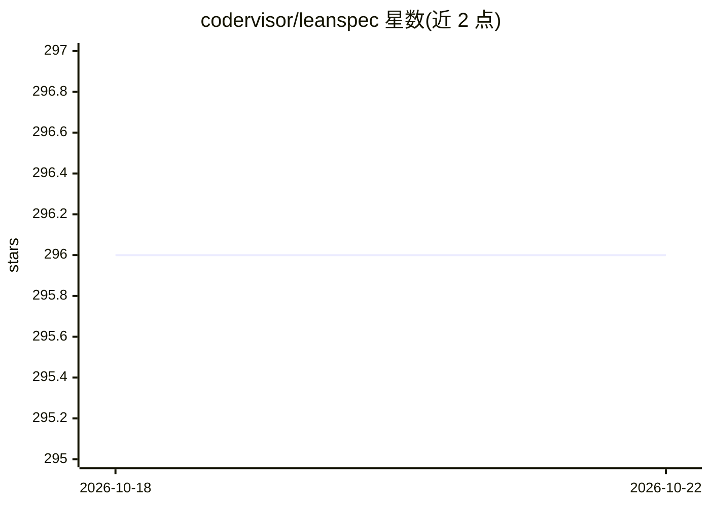

# codervisor/leanspec

⭐ 297 · Rust · MIT · 推送 2026-05-20 · [GitHub](https://github.com/codervisor/leanspec) · [官网](https://lean-spec.dev) · 个人维护 · 中文 README

**工具无关的规格驱动开发（SDD）框架，统一 CLI/MCP/UI 接入 AI 助手**

面向开发者的规格编码框架：在既有规格工作流（Markdown、GitHub Issues、ADO、Jira、Linear）之上提供统一接口，包含 CLI、MCP 服务器与 Web UI（看板、搜索、统计）。规格文档小于 2K token 以控制 AI 上下文消耗，可安装 agent skill 向 AI 助手传授 SDD 方法论（Discover→Design→Implement→Validate）。当前仅 Markdown provider 可用，GitHub/ADO 为 Planned，Jira/Linear 为 Future；桌面应用已迁移至独立仓库。需 Node.js>=20 与 pnpm>=10，开发构建另需 Rust>=1.70。

## 筛选速览

| 维度 | 判定 | 备注 |
|---|---|---|
| AI 角色 | `ai-ecosystem` | LLM/agent 周边工具 |
| 许可风险 | `permissive` | MIT |
| 部署形态 | `library` | 以包/库形式分发 |
| 模型依赖 | — | README 未给出锁定关系 |
| 硬件要求 | — | 无带数字的原话,不猜 |
| 安装摩擦 | `low` | 无编译、无系统依赖或容器化 |
| 成熟度 | — | 结构信号不足 |

## 能力要点

- 统一 CLI、MCP 服务器与 Web UI，后端无关的 provider 架构
- 规格 <2K token 的上下文经济设计
- npx skills 安装 leanspec skill 向 AI agent 传授 SDD 流程
- 看板、依赖追踪、项目统计等管理功能

## 适用场景

- 在既有 Jira/GitHub Issues/Markdown 工作流上实践规格驱动开发
- 让 Claude Code/Cursor 等 AI 助手按结构化规格实施开发
- 可视化追踪规格状态与项目健康度

## 场景标签

 · 领域:开发工具/规格驱动开发

## 证据(README 行号)

> L58: - **AI-native** - Structured spec data for any AI coding assistant
> L66: Works with any AI coding assistant via MCP or CLI:
> L71:     "leanspec": { "command": "npx", "args": ["@leanspec/mcp"] }

## 星数曲线

2026-10-18 296 → 2026-10-22 296（+0）

---
*卡片 v1 · prompt 1.4 · 生成 2026-10-21 · 置信度 high · 依据 README sha `1e9c98a4e619` · [字段定义](../../DATASET.md)*
