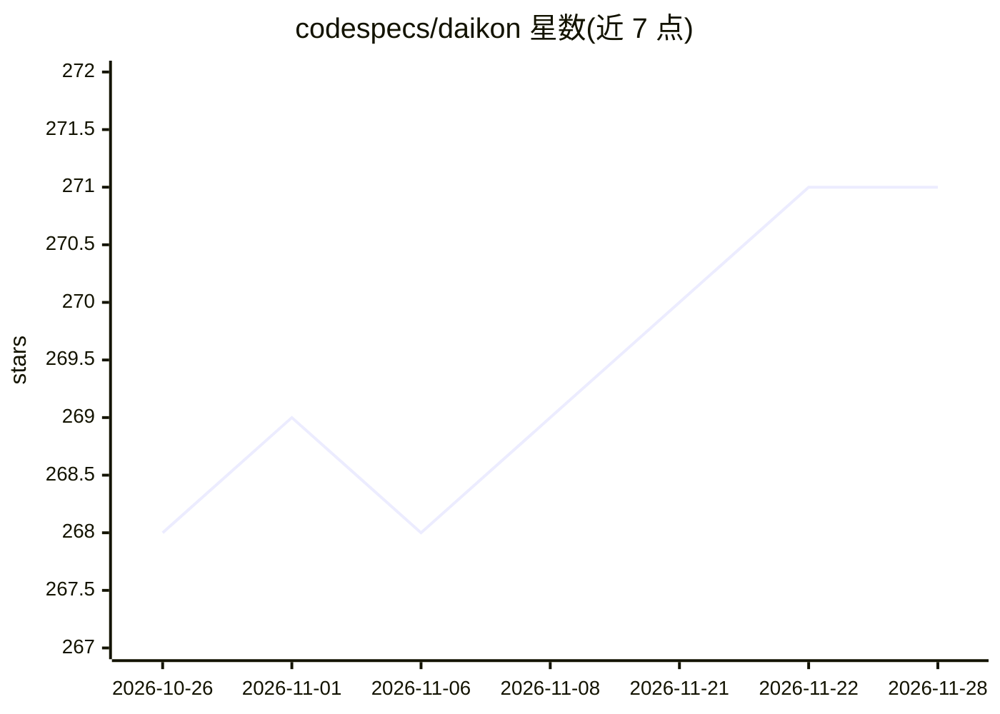

# codespecs/daikon

⭐ 271 · C · NOASSERTION · 推送 2026-11-27 · [GitHub](https://github.com/codespecs/daikon) · [官网](http://plse.cs.washington.edu/daikon/) · 组织维护

**从程序运行轨迹中动态检测可能不变式的工具**

Daikon 是华盛顿大学发布的动态不变式检测器（5.9.1 版，2026 年 9 月发布），通过分析程序运行轨迹生成变量间可能成立的规格说明（不变式）。支持 Java、C、C#、Eiffel、Perl 等语言。从官网下载的分发包开箱即用，详细安装与使用说明位于 doc 子目录及项目主页；从源码仓库克隆则需要查阅 README.source。

## 筛选速览

| 维度 | 判定 | 备注 |
|---|---|---|
| AI 角色 | `ai-native` | 本体是模型或模型工具 |
| 许可风险 | `none` | NOASSERTION |
| 部署形态 | `None` |  |
| 模型依赖 | — | README 未给出锁定关系 |
| 硬件要求 | — | 无带数字的原话,不猜 |
| 安装摩擦 | `low` | 无编译、无系统依赖或容器化 |
| 成熟度 | — | 结构信号不足 |

## 能力要点

- 动态分析程序运行轨迹以生成可能不变式
- 支持 Java、C、C#、Eiffel、Perl 等多种语言
- 官网分发包开箱即用，文档随包提供

## 适用场景

- 为代码推断规格说明以辅助理解程序行为
- 为测试或验证生成候选不变式断言

## 场景标签

 · 领域:软件工程/程序分析

## 证据(README 行号)

> L1: This is the distribution of the Daikon invariant detector,
> L10:  https://plse.cs.washington.edu/daikon/

## 星数曲线

2026-10-26 268 → 2026-11-28 271（+3）

---
*卡片 v1 · prompt 1.4 · 生成 2026-11-25 · 置信度 mid · 依据 README sha `3fe541fd276f` · [字段定义](../../DATASET.md)*
