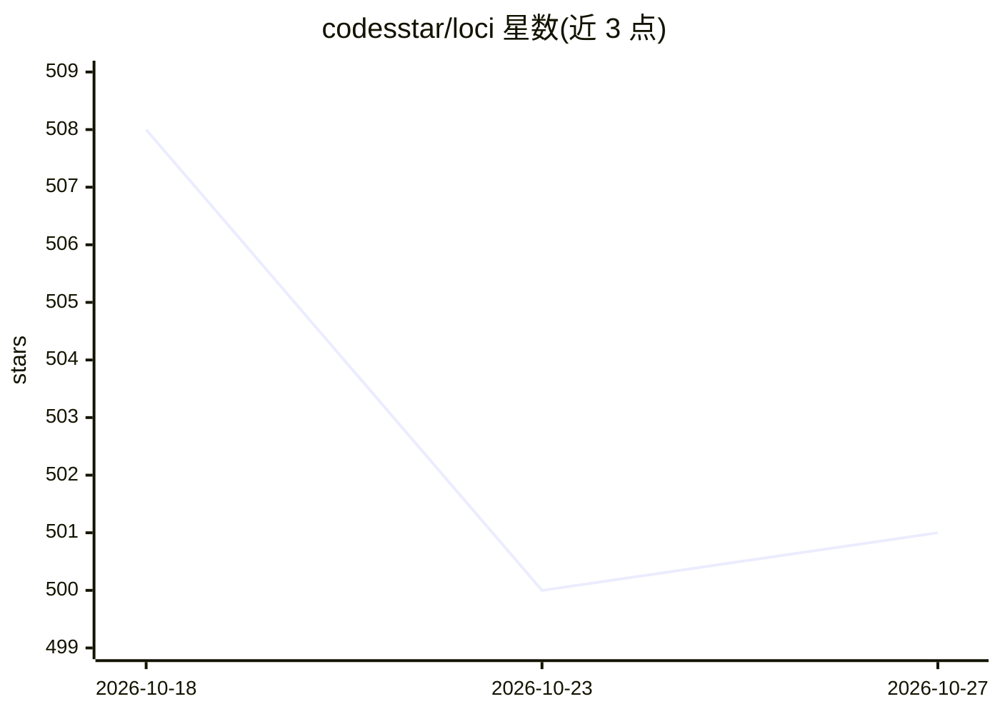

# codesstar/loci

⭐ 501 · HTML · MIT · 推送 2026-10-23 · [GitHub](https://github.com/codesstar/loci) · 个人维护 · 中文 README

**给 AI 编码工具的本地记忆宫殿：跨 Agent 共享记忆与项目上下文**

面向使用 Claude Code、Codex、Hermes、千问工作、豆包工作等 Agent 的用户的本地记忆与数据层：以 Markdown、JSON 与附件将个人记忆、任务日程、人脉、知识库保存到本机"大脑"目录，通过 LOCI.md 入口与 LOCI-RULES.md 规则手册指导 Agent 读写，接入同一大脑的 Agent 可共享上下文。附本机运行的 Node.js Dashboard。实际读写由 Agent 的文件/命令工具执行，规则文件不能强制模型遵守；需 Node.js 18+ 与 Git，无需外部数据库。

## 筛选速览

| 维度 | 判定 | 备注 |
|---|---|---|
| AI 角色 | `ai-ecosystem` | LLM/agent 周边工具 |
| 许可风险 | `permissive` | MIT |
| 部署形态 | `None` |  |
| 模型依赖 | — | README 未给出锁定关系 |
| 硬件要求 | — | 无带数字的原话,不猜 |
| 安装摩擦 | `low` | 无编译、无系统依赖或容器化 |
| 成熟度 | — | 结构信号不足 |

## 能力要点

- 本地 Markdown/JSON 存储个人记忆、任务、人脉与知识库，可直接查看修改
- LOCI.md 短入口 + LOCI-RULES.md 手册的按需读取架构，不启动时全量加载
- 支持 7 种 Agent 接入同一大脑，共享上下文
- 通过让 AI 执行安装文档完成安装，无需 npm 包

## 适用场景

- 在不同 AI 编码工具间保留我的偏好、任务和项目背景
- 让 Agent 记住称呼、语言习惯和待办提醒
- 用 Dashboard 在本机查看和整理 Agent 记录的信息

## 场景标签

`Agent 记忆` `知识库管理` · 领域:Agent 开发

## 证据(README 行号)

> L17: Loci 把这些内容放进你自己的本地“大脑”目录，通过各 Agent 的指令入口告诉它们：去哪里读、什么值得记、怎样写入。接入同一个大脑的 Agent，可以读取已经保存的共同上下文。
> L19: 记忆、任务、日程、人脉和知识资料使用 Markdown、JSON 与附件保存。你可以直接打开文件，也可以通过 Dashboard 查看和修改。无需部署外部数据库或云端记忆服务；Dashboard 是在本机运行的 Node.js 服
> L41: 实际读写由 Agent 的文件/命令工具执行。效果取决于工具是否加载规则、能否访问大脑，以及是否正确执行操作；仅安装文件不会强制模型遵守规则。

## 星数曲线

2026-10-18 508 → 2026-10-27 501（-7）

---
*卡片 v1 · prompt 1.4 · 生成 2026-10-21 · 置信度 high · 依据 README sha `6245a3272dc4` · [字段定义](../../DATASET.md)*
