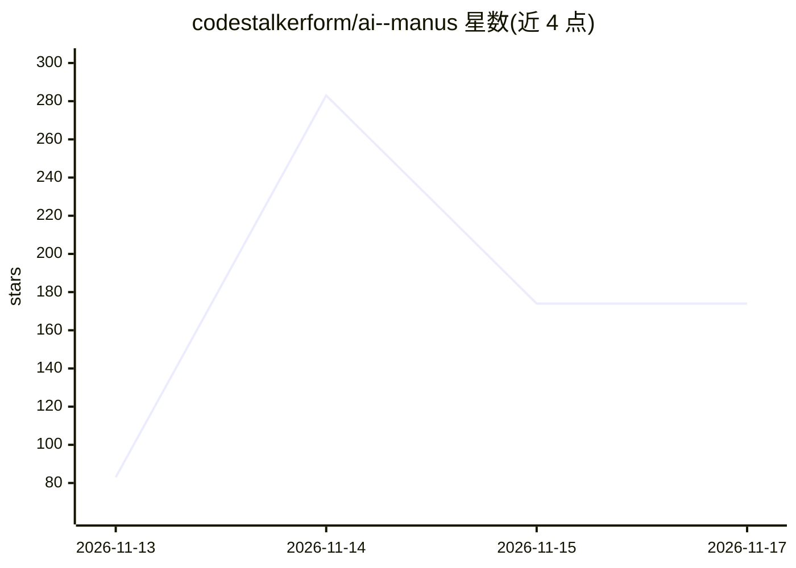

# codestalkerform/ai--manus

⭐ 174 · Apache-2.0 · 推送 2026-11-15 · [GitHub](https://github.com/codestalkerform/ai--manus) · 个人维护

**面向个人用户的通用自主 AI Agent：代用户执行代码与操控浏览器**

README 宣称的自主 AI 代理：代替用户编写并执行脚本、操控浏览器（导航网页、填写表单、抓取信息），可跨会话记住任务模式并执行多步任务，面向学习、家庭与轻量办公场景。描述为沙箱环境中运行多种工具的通用 Agent 系统。README 为营销式介绍，未给出安装命令、模型接入方式、代码结构或配置细节，仅列硬件兼容表与使用流程建议；对底层模型与实现无可验证信息。

## 筛选速览

| 维度 | 判定 | 备注 |
|---|---|---|
| AI 角色 | `ai-native` | 本体是模型或模型工具 |
| 许可风险 | `permissive` | Apache-2.0 |
| 部署形态 | `None` |  |
| 模型依赖 | — | README 未给出锁定关系 |
| 硬件要求 | — | 无带数字的原话,不猜 |
| 安装摩擦 | `low` | 无编译、无系统依赖或容器化 |
| 成熟度 | — | 结构信号不足 |

## 能力要点

- 自主执行代码与浏览器操控（导航/填表/抓取）
- 跨会话记住任务模式并重复执行多步任务
- 面向家庭、学习与轻量办公的小规模场景

## 适用场景

- 让 AI 代为跑小脚本并整理研究结果
- 自动浏览多页面收集信息并生成摘要
- 把重复性的网页操作和文件整理交给后台代理

## 场景标签

`AI 助手` `浏览器自动化` · 领域:效率与自动化

## 证据(README 行号)

> L10: - **Autonomous Code Execution:** Manus AI agent runs code on its own to complete tasks, so you can focus on decisio
> L18: Manus is an autonomous AI agent designed to run code and control a browser on your behalf. Instead of acting like a

## 星数曲线

2026-11-13 83 → 2026-11-17 174（+91）

---
*卡片 v1 · prompt 1.4 · 生成 2026-11-17 · 置信度 mid · 依据 README sha `0f78ee3a5dd2` · [字段定义](../../DATASET.md)*
