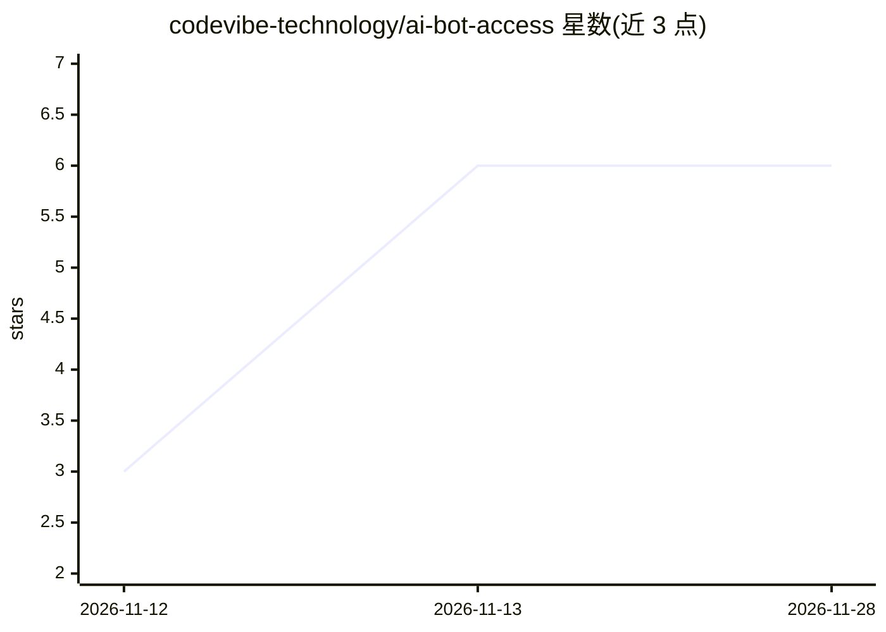

# codevibe-technology/ai-bot-access

⭐ 6 · TypeScript · MIT · 推送 2026-11-15 · [GitHub](https://github.com/codevibe-technology/ai-bot-access) · [官网](https://codevibe.in/tools/ai-bot-access) · 组织维护

**网站管理员检测 AI 爬虫能否真实读取站点的 CLI 审计工具**

面向网站所有者的 Node.js CLI：一条命令对 24 个 AI 爬虫、搜索引擎与社交链接预览 bot 各发起真实请求，结合 RFC 9309 解析 robots.txt，并比对浏览器基线响应，输出 allowed / blocked-by-robots / blocked-by-server / challenged 等判定及修复建议。另提供按运营商公布的 IP 列表核验 bot 真伪、读取 nginx/Apache/JSON 日志生成爬虫访问报告、分享预览（og 标签）检查，支持 CI 定时运行与代码内调用（Next.js 中间件、Express）。零依赖，无 API key，需 Node.js 18.17+。

## 筛选速览

| 维度 | 判定 | 备注 |
|---|---|---|
| AI 角色 | `ai-enhanced` | 去掉 AI 部分产品仍成立 |
| 许可风险 | `permissive` | MIT |
| 部署形态 | `library` | 以包/库形式分发 |
| 模型依赖 | — | README 未给出锁定关系 |
| 硬件要求 | — | 无带数字的原话,不猜 |
| 安装摩擦 | `low` | 无编译、无系统依赖或容器化 |
| 成熟度 | — | 结构信号不足 |

## 能力要点

- 对 24 个 bot 以各自 user agent 发起真实请求，比对浏览器基线
- 基于运营商公布的 IP 列表与反向 DNS 核验 bot 真伪
- 读取 nginx/Apache combined 与 JSON 日志，统计真实爬虫被拒情况与 AI 助手带来的访客
- 识别主机/CDN（Cloudflare、Vercel 等）并给出对应设置入口

## 适用场景

- 上线后确认 GPTBot、ClaudeBot 等 AI 爬虫没有被主机或 CDN 静默拦截
- 核验访问日志里自称 GPTBot 的请求是否来自真实地址
- 把爬虫可达性检查加入 CI 每周运行
- 检查链接在社交平台分享时的预览卡片是否正常

## 场景标签

 · 领域:网站运维/搜索引擎与 AI 可见性

## 证据(README 行号)

> L10:  One command checks 24 AI, search and link-preview bots against your robots.txt and your real server response.
> L28: npx ai-bot-access https://your-site.com                          # can every bot read this page?
> L33: No install, no API key, no account, zero dependencies. Needs Node.js 18.17 or newer.

## 星数曲线

2026-11-12 3 → 2026-11-28 6（+3）

---
*卡片 v1 · prompt 1.4 · 生成 2026-11-20 · 置信度 high · 依据 README sha `614b51052fd7` · [字段定义](../../DATASET.md)*
