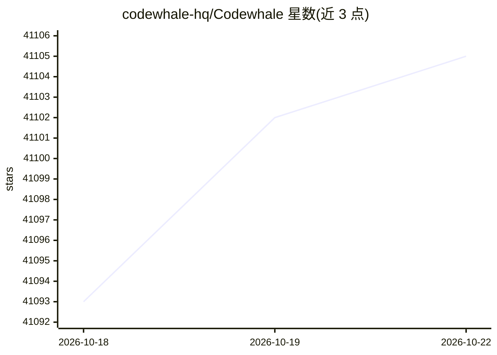

# codewhale-hq/Codewhale

⭐ 41,108 · Rust · MIT · 推送 2026-10-22 · [GitHub](https://github.com/codewhale-hq/Codewhale) · [官网](https://codewhale.net/) · 组织维护

**开源 Rust 终端编码 agent，支持 40+ 模型提供商**

用 Rust 编写的终端编码 agent 及共享同一引擎的 CLI/网页/HTTP API 形态：接收任务后读取仓库、编辑文件、运行命令直至完成。内置 40+ 提供商（默认 DeepSeek，兼容 OpenAI 端点及 Ollama/vLLM/SGLang 本地模型）。提供 Plan/Work/Operate 三种模式与 Ask/Auto-Review/Full Access 三级权限，OS 沙箱隔离，`/receipts` 记录文件变更、命令与调用，`/undo` 回滚。支持 MCP、插件、子 agent 与工作流；MIT 许可，无需账号。

## 筛选速览

| 维度 | 判定 | 备注 |
|---|---|---|
| AI 角色 | `ai-native` | 本体是模型或模型工具 |
| 许可风险 | `permissive` | MIT |
| 部署形态 | `library` | 以包/库形式分发 |
| 模型依赖 | local-ok | 支持本地模型 |
| 硬件要求 | — | 无带数字的原话,不猜 |
| 安装摩擦 | `low` | 无编译、无系统依赖或容器化 |
| 成熟度 | `idea` | |

## 动量与使用信号

- 维护:`active` — 距上次 push 0.7 天,年发版 100,209 位贡献者
- 涨星:近 1 天 **+1**(自 20261016 起算)
- 安装:npm 包 `codewhale` 月下载 23,668
- 平台:WINDOWS / MACOS / LINUX / ANDROID · 协议:OPENAI-API / MCP / OLLAMA

## 能力要点

- 内置 40+ 提供商，默认 DeepSeek，支持 Ollama/vLLM/SGLang 本地模型
- Plan/Work/Operate 模式与 Ask/Auto-Review/Full Access 权限分级
- `/receipts` 记录全部变更与调用，`/undo`/`/restore` 回滚
- exec/web/app-server/ACP 多运行形态共享同一引擎

## 适用场景

- 在终端里让 AI 修复测试、编辑代码并解释改动
- 在 CI 或脚本中以 `codewhale exec` 自动执行单次任务
- 对 GitHub PR 运行顾问式审查
- 通过 MCP 服务器与插件扩展 agent 能力

## 场景标签

`编码 Agent` · 领域:编码与开发

## 证据(README 行号)

> L5: Give Codewhale a task and it reads the repository, edits files, and runs
> L123: More than 40 providers are built in, including Anthropic, OpenAI, DeepSeek,

## 星数曲线

2026-10-18 41,093 → 2026-10-22 41,105（+12）

---
*卡片 v1 · prompt 1.4 · 生成 2026-10-20 · 置信度 high · 依据 README sha `0c86a5b67a84` · [字段定义](../../DATASET.md)*
