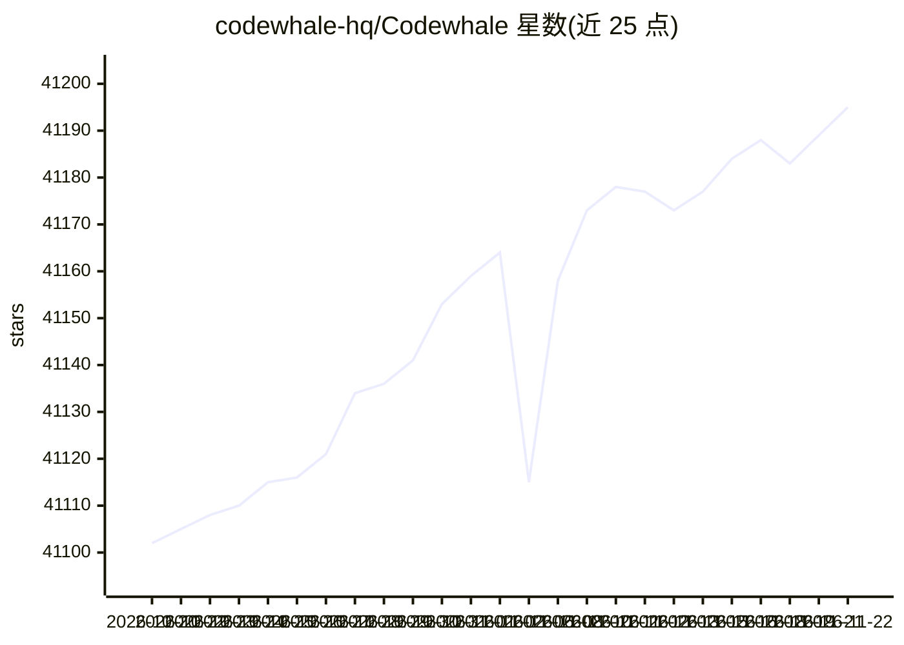

# codewhale-hq/Codewhale

⭐ 41,195 · Rust · MIT · 推送 2026-11-21 · [GitHub](https://github.com/codewhale-hq/Codewhale) · [官网](https://codewhale.net/) · 个人维护

**终端里的开源 Rust 编码代理，可接任意模型并多代理分工**

以 Rust 编写的终端编码代理：读取仓库、编辑文件并运行命令直至任务完成，通过 Plan/Work/Operate 模式与 Ask/Auto-Review/Full Access 权限档控制自主程度，提供回执清单、/undo 与 /restore 回滚、OS 级沙箱（macOS Seatbelt、Linux bubblewrap）。内置 40 余个 provider，默认 DeepSeek，支持 OpenAI 兼容端点与 Ollama/vLLM/SGLang 本地模型；可将任务拆分给带角色和模型的子代理/Fleet。提供交互终端、exec 无头运行、本地 web 客户端、PR 审查、HTTP Runtime API 与 ACP 编辑器接入等多种运行方式，另支持 MCP/插件/skills/hook 扩展。

## 筛选速览

| 维度 | 判定 | 备注 |
|---|---|---|
| AI 角色 | `ai-ecosystem` | LLM/agent 周边工具 |
| 许可风险 | `permissive` | MIT |
| 部署形态 | `library` | 以包/库形式分发 |
| 模型依赖 | local-ok | 支持本地模型 |
| 硬件要求 | — | 无带数字的原话,不猜 |
| 安装摩擦 | `low` | 无编译、无系统依赖或容器化 |
| 成熟度 | — | 结构信号不足 |

## 动量与使用信号

- 维护:`active` — 距上次 push 0.7 天,年发版 100,209 位贡献者
- 涨星:近 1 天 **+1**(自 20261016 起算)
- 安装:npm 包 `codewhale` 月下载 23,668
- 平台:WINDOWS / MACOS / LINUX / ANDROID · 协议:OPENAI-API / MCP / OLLAMA

## 能力要点

- 内置 40+ provider，支持 OpenAI 兼容端点与 Ollama/vLLM/SGLang 本地模型
- 多代理协作：子代理、Fleet 与仓库内工作流
- 回执与回滚：/receipts 列出文件改动、命令、MCP 调用与审批记录，/undo /restore 回退
- OS 沙箱与分级权限（Ask/Auto-Review/Full Access），无账户、密钥留本机

## 适用场景

- 在终端让代理完成修测试、改代码、跑命令的开发任务
- 用自有 API key 或本地模型驱动编码代理，费用可控
- 在脚本与 CI 中以 codewhale exec 无头运行任务
- 把任务拆给多个带不同角色与模型的代理协作完成

## 场景标签

`编码 Agent` `多智能体` · 领域:Agent 开发

## 证据(README 行号)

> L5: Codewhale is an open-source coding agent for your terminal, written in Rust.
> L83: More than 40 providers are built in, including Anthropic, OpenAI, DeepSeek,
> L54: 2. Run `/provider` (or press `F3`), pick a provider, paste its API key and

## 星数曲线

2026-10-20 41,102 → 2026-11-22 41,195（+93）

---
*卡片 v1 · prompt 1.4 · 生成 2026-11-22 · 置信度 high · 依据 README sha `5986a5a4cc49` · [字段定义](../../DATASET.md)*
