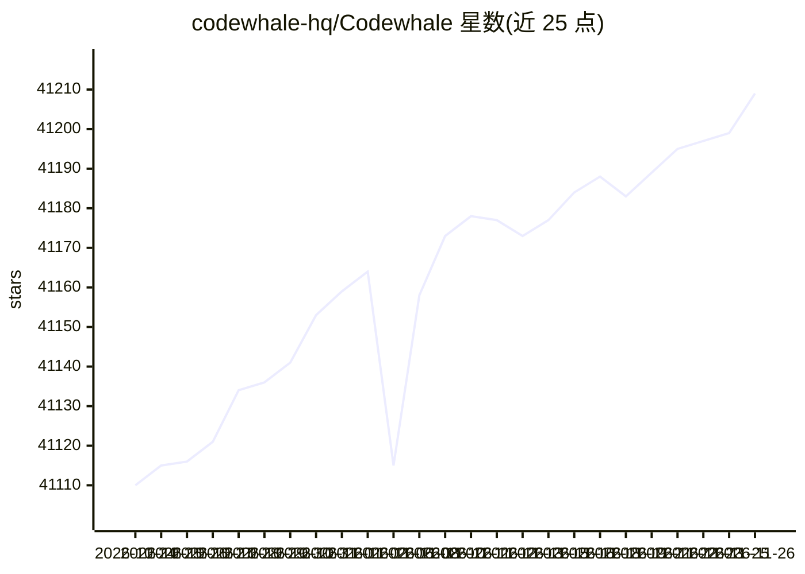

# codewhale-hq/Codewhale

⭐ 41,209 · Rust · MIT · 推送 2026-11-25 · [GitHub](https://github.com/codewhale-hq/Codewhale) · [官网](https://codewhale.net/) · 个人维护 · 中文 README

**Rust 编写的终端编码 agent：接任意模型、多 agent 协作、可回滚**

开源 Rust 编码 agent，提供终端交互、headless 执行、本地 Web 客户端、HTTP Runtime API 与 ACP 编辑器接入等多个入口。内置 50+ provider 与本地模型路由，支持子 agent 与 Fleets 协作、MCP/插件/钩子扩展、 receipts 记录与 /undo /restore 回滚，命令在 macOS Seatbelt 或 Linux bubblewrap 沙箱中运行并按权限模式审批。API key 留存本机，聚合遥测可用命令关闭。提供 curl 安装脚本、winget/npm/cargo 等多种安装方式。

## 筛选速览

| 维度 | 判定 | 备注 |
|---|---|---|
| AI 角色 | `ai-ecosystem` | LLM/agent 周边工具 |
| 许可风险 | `permissive` | MIT |
| 部署形态 | `library` | 以包/库形式分发 |
| 模型依赖 | local-ok | 支持本地模型 |
| 硬件要求 | — | 无带数字的原话,不猜 |
| 安装摩擦 | `low` | 无编译、无系统依赖或容器化 |
| 成熟度 | — | 结构信号不足 |

## 动量与使用信号

- 维护:`active` — 距上次 push 0.7 天,年发版 100,209 位贡献者
- 涨星:近 1 天 **+1**(自 20261016 起算)
- 安装:npm 包 `codewhale` 月下载 23,668
- 平台:WINDOWS / MACOS / LINUX / ANDROID · 协议:OPENAI-API / MCP / OLLAMA

## 能力要点

- 50+ 内置 provider，支持 Ollama/vLLM/SGLang 本地运行时与会中 /model 切换
- receipts 记录改动文件、命令、MCP 调用，支持 /undo 与 /restore 快照回滚
- OS 沙箱（Seatbelt/bubblewrap）与五档权限模式控制命令执行
- MCP、skills、hooks、插件扩展，兼容 AGENTS.md 并可导入 Claude Code 配置

## 适用场景

- 在终端里让 AI 修复失败的测试并逐条审批命令
- 用本地 Ollama 模型离线完成代码编辑任务
- 通过 headless 模式在脚本和 CI 中跑单任务
- 对 GitHub PR 做辅助性代码审查

## 场景标签

`编码 Agent` `多智能体` `代码审查` · 领域:Agent 开发

## 证据(README 行号)

> L3: **Open-source Rust coding agent for your terminal. Any model, multi-agent fleets, OS sandboxing, and verifiable rece
> L63: - **50+ built-in providers and local models:** Anthropic, OpenAI, DeepSeek
> L104: All entry points share one Rust engine (architecture).

## 星数曲线

2026-10-24 41,110 → 2026-11-26 41,209（+99）

---
*卡片 v1 · prompt 1.4 · 生成 2026-11-26 · 置信度 high · 依据 README sha `ca524983f574` · [字段定义](../../DATASET.md)*
