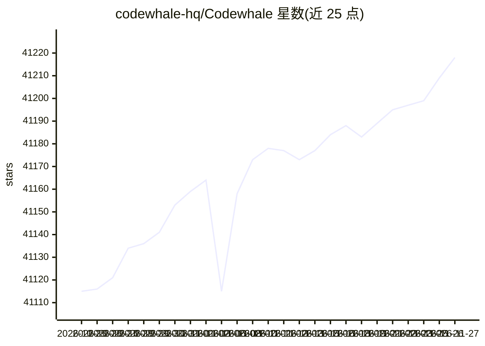

# codewhale-hq/Codewhale

⭐ 41,218 · Rust · MIT · 推送 2026-11-26 · [GitHub](https://github.com/codewhale-hq/Codewhale) · [官网](https://codewhale.net/) · 个人维护 · 中文 README

**开源 Rust 终端编码 Agent：任意模型、多 Agent、收据与回滚**

以 Rust 编写的开源编码 Agent，提供终端交互、headless exec、本地 Web 客户端、HTTP Runtime API 与 ACP 编辑器接口等多个入口。内置 50+ 模型提供方与本地运行时接入，支持子 Agent/Fleet 编排、MCP/插件/钩子、五级权限模式与 macOS Seatbelt/Linux bubblewrap 沙箱；/receipts 记录变更、/undo 与 /restore 支持回滚。预编译二进制覆盖 Linux/macOS/Windows（x64/arm64），默认遥测可通过配置关闭。

## 筛选速览

| 维度 | 判定 | 备注 |
|---|---|---|
| AI 角色 | `ai-ecosystem` | LLM/agent 周边工具 |
| 许可风险 | `permissive` | MIT |
| 部署形态 | `library` | 以包/库形式分发 |
| 模型依赖 | local-ok | 支持本地模型 |
| 硬件要求 | — | 无带数字的原话,不猜 |
| 安装摩擦 | `low` | 无编译、无系统依赖或容器化 |
| 成熟度 | — | 结构信号不足 |

## 动量与使用信号

- 维护:`active` — 距上次 push 0.7 天,年发版 100,209 位贡献者
- 涨星:近 1 天 **+1**(自 20261016 起算)
- 安装:npm 包 `codewhale` 月下载 23,668
- 平台:WINDOWS / MACOS / LINUX / ANDROID · 协议:OPENAI-API / MCP / OLLAMA

## 能力要点

- 内置 50+ 提供方接入，含 Ollama/vLLM/SGLang 本地运行时与会话中切换模型
- receipts 记录文件变更、命令、MCP 调用与审批，/undo、/restore 回滚
- 五级权限模式与 OS 沙箱（Seatbelt/bubblewrap），沙箱内屏蔽凭证路径
- MCP、skills、hooks、插件体系，支持导入 Claude Code 设置与插件

## 适用场景

- 在终端里让模型完成修测试、改代码等任务并逐步审批
- 接入本地 Ollama 模型做无 API key 的离线编码会话
- CI 中以 headless 模式跑单任务或对 GitHub PR 做评审
- 用 Fleet/子 Agent 把角色化任务分发给不同模型

## 场景标签

`编码 Agent` `多智能体` · 领域:Agent 开发

## 证据(README 行号)

> L63: - **50+ built-in providers and local models:** Anthropic, OpenAI, DeepSeek
> L97: |`codewhale`|Interactive terminal app|
> L104: All entry points share one Rust engine (architecture).

## 星数曲线

2026-10-25 41,115 → 2026-11-27 41,218（+103）

---
*卡片 v1 · prompt 1.4 · 生成 2026-11-27 · 置信度 high · 依据 README sha `4e3f7728ab92` · [字段定义](../../DATASET.md)*
