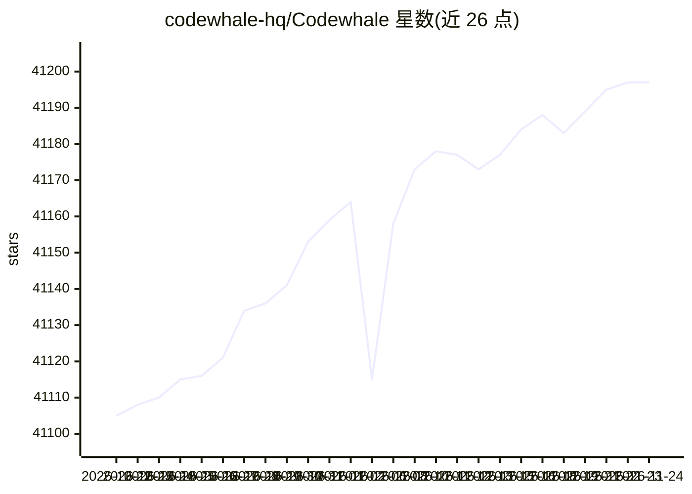

# codewhale-hq/Codewhale

⭐ 41,199 · Rust · MIT · 推送 2026-11-24 · [GitHub](https://github.com/codewhale-hq/Codewhale) · [官网](https://codewhale.net/) · 个人维护 · 中文 README

**Rust 编写的开源终端编码 agent，接任意模型**

面向在终端中完成编码任务的开发者：给定任务后读取仓库、编辑文件并执行命令，直到完成或等待用户输入。机制上支持 40+ 内置 provider 与任意 OpenAI 兼容端点、本地模型（Ollama/vLLM/SGLang），可将任务拆分给多个子 agent（Fleet/工作流），提供 receipts 审计、单步 /undo、快照 /restore、五档自主权限（Ask→Full Access）与 macOS/Linux 沙箱；安装提供 shell 脚本、winget、npm、cargo，无账户要求，API key 留在本机。Windows 暂无 OS 沙箱。

## 筛选速览

| 维度 | 判定 | 备注 |
|---|---|---|
| AI 角色 | `ai-native` | 本体是模型或模型工具 |
| 许可风险 | `permissive` | MIT |
| 部署形态 | `library` | 以包/库形式分发 |
| 模型依赖 | local-ok | 支持本地模型 |
| 硬件要求 | — | 无带数字的原话,不猜 |
| 安装摩擦 | `low` | 无编译、无系统依赖或容器化 |
| 成熟度 | — | 结构信号不足 |

## 动量与使用信号

- 维护:`active` — 距上次 push 0.7 天,年发版 100,209 位贡献者
- 涨星:近 1 天 **+1**(自 20261016 起算)
- 安装:npm 包 `codewhale` 月下载 23,668
- 平台:WINDOWS / MACOS / LINUX / ANDROID · 协议:OPENAI-API / MCP / OLLAMA

## 能力要点

- 内置 40+ provider，支持 OpenAI 兼容端点与 Ollama/vLLM/SGLang 本地模型
- 多 agent 协作：子 agent、Fleet、仓库内工作流拆分同一任务
- Receipts 记录文件改动、命令、MCP 调用与审批，支持 /undo 与 /restore
- 五档权限模式加 OS 沙箱（macOS Seatbelt / Linux bubblewrap）

## 适用场景

- 在终端里让 agent 修复失败测试并解释改动
- 用自带 API key 在 CI 中以 codewhale exec 无界面跑任务
- 通过 MCP 服务器与插件扩展 agent 工具能力
- 用本地模型在不联网、不用 key 的情况下改代码

## 场景标签

`编码 Agent` `多智能体` `模型网关` `工作流自动化` · 领域:Agent 开发

## 证据(README 行号)

> L5: Codewhale is an open-source coding agent for your terminal, written in Rust.
> L83: More than 40 providers are built in, including Anthropic, OpenAI, DeepSeek,
> L104: `/goal` sets an objective that carries across turns. Codewhale can split work

## 星数曲线

2026-10-22 41,105 → 2026-11-24 41,197（+92）

---
*卡片 v1 · prompt 1.4 · 生成 2026-11-24 · 置信度 high · 依据 README sha `8e5d36aea98a` · [字段定义](../../DATASET.md)*
