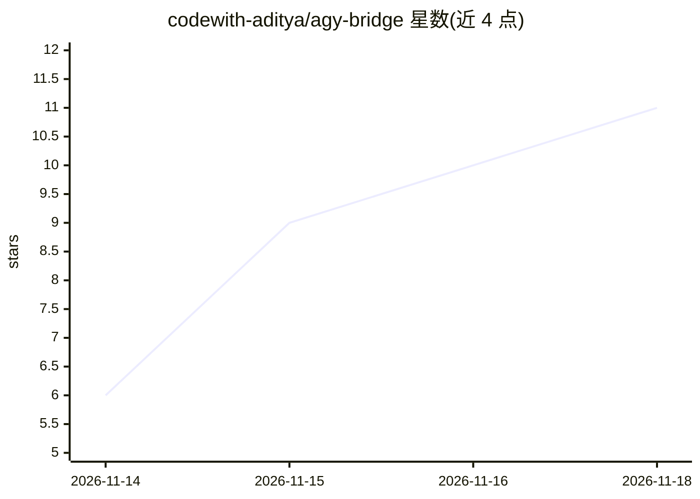

# codewith-aditya/agy-bridge

⭐ 11 · Go · MIT · 推送 2026-11-17 · [GitHub](https://github.com/codewith-aditya/agy-bridge) · 个人维护

**协议转换代理：让 Google Antigravity 接任意 OpenAI 兼容模型**

用 Go 编写的协议桥接代理：Antigravity CLI 走 Gemini v1beta、IDE/hub 走 Cloud Code v1internal，两者都支持端点覆盖；本工具在该覆盖点上把 Gemini 线格式翻译为 OpenAI /chat/completions，含流式 SSE 重组与 functionDeclarations↔tools 的 1:1 工具调用映射，并合成交互 ID 处理 functionResponse 缺失 call id 的问题。Cloud Code 路由仅重定向生成请求，登录/模型目录/配额仍透传给 Google。无第三方依赖，单二进制。

## 筛选速览

| 维度 | 判定 | 备注 |
|---|---|---|
| AI 角色 | `ai-ecosystem` | LLM/agent 周边工具 |
| 许可风险 | `permissive` | MIT |
| 部署形态 | `desktop` | 安装包/桌面程序 |
| 模型依赖 | — | README 未给出锁定关系 |
| 硬件要求 | — | 无带数字的原话,不猜 |
| 安装摩擦 | `low` | 无编译、无系统依赖或容器化 |
| 成熟度 | — | 结构信号不足 |

## 能力要点

- 双协议端点：Gemini v1beta（CLI）与 Cloud Code v1internal（IDE/hub）
- 流式 SSE 重组与工具调用双向映射（含 call id 合成）
- 选择性代理：非生成 RPC 仍以调用者令牌透传 Google
- 纯标准库，单静态二进制，支持 Linux/macOS/Windows

## 适用场景

- 用 OpenRouter/Groq 或本地 vLLM、Ollama 的模型驱动 Antigravity
- 让 Antigravity IDE 的模型选择器接入自建网关
- 团队共享一个上游端点，各成员用各自 key 计费

## 场景标签

`模型网关` · 领域:Agent 开发

## 证据(README 行号)

> L7: Cloud Code API; both accept an endpoint override. `agy-bridge` sits on that override and translates
> L8: the Gemini wire format into an OpenAI-compatible one, including streaming and full tool calling.
> L29: - **Two protocols, one binary.** Public Gemini (`v1beta/models/{model}:generateContent`) for the CLI,

## 星数曲线

2026-11-14 6 → 2026-11-18 11（+5）

---
*卡片 v1 · prompt 1.4 · 生成 2026-11-18 · 置信度 high · 依据 README sha `6aad2b54f934` · [字段定义](../../DATASET.md)*
