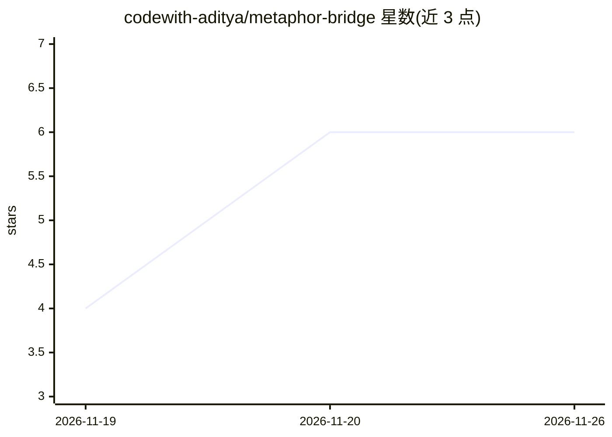

# codewith-aditya/metaphor-bridge

⭐ 6 · Go · MIT · 推送 2026-11-24 · [GitHub](https://github.com/codewith-aditya/metaphor-bridge) · 个人维护

**Linux 下访问 Metaphor 模型网关的本地 OpenAI 兼容桥**

用 Go 编写的本地代理：通过 WorkOS PKCE 登录用户自己的 Metaphor 账号并自动刷新令牌，在 127.0.0.1:8190 暴露 OpenAI/Anthropic 兼容端点，使任意 OpenAI 客户端和 SDK 可直接调用 llms.withmetaphor.com 网关。提供 SSE 流式透传、请求队列与 429/503 重试、出站代理支持、/healthz 与 /debug/ip 端点。上游仅允许约 1-2 个并发请求，官方桌面应用不支持 Linux，此桥即为此场景提供。

## 筛选速览

| 维度 | 判定 | 备注 |
|---|---|---|
| AI 角色 | `ai-ecosystem` | LLM/agent 周边工具 |
| 许可风险 | `permissive` | MIT |
| 部署形态 | `desktop` | 安装包/桌面程序 |
| 模型依赖 | — | README 未给出锁定关系 |
| 硬件要求 | — | 无带数字的原话,不猜 |
| 安装摩擦 | `low` | 无编译、无系统依赖或容器化 |
| 成熟度 | — | 结构信号不足 |

## 能力要点

- OpenAI 兼容端点（/v1/models、/v1/chat/completions、/v1/messages、/v1/responses），任意 OpenAI SDK 可用
- WorkOS PKCE 登录与基于 JWT exp 的令牌自动刷新，支持 GitHub cookie 无头登录
- SSE 流式逐字节透传、请求队列与 Retry-After 重试、HTTP/2 上游
- 支持 http/https/socks5 出站代理，应用于网关与认证跳段

## 适用场景

- 在 Linux 上无需官方桌面应用访问 Metaphor 模型网关
- 将现有 OpenAI 客户端 base_url 指向本地桥直接调用网关模型
- CI/headless 环境用 GitHub cookie 完成非交互登录
- 受 IP 限流时通过出站代理完成认证与请求

## 场景标签

`模型网关` · 领域:Agent 开发

## 证据(README 行号)

> L8: Metaphor uses), keeps it fresh, and exposes the gateway on `127.0.0.1` so any
> L111: Any OpenAI SDK works: `base_url = http://127.0.0.1:8190/v1`, `api_key` = anything.

## 星数曲线

2026-11-19 4 → 2026-11-26 6（+2）

---
*卡片 v1 · prompt 1.4 · 生成 2026-11-20 · 置信度 high · 依据 README sha `6d6aff52038c` · [字段定义](../../DATASET.md)*
