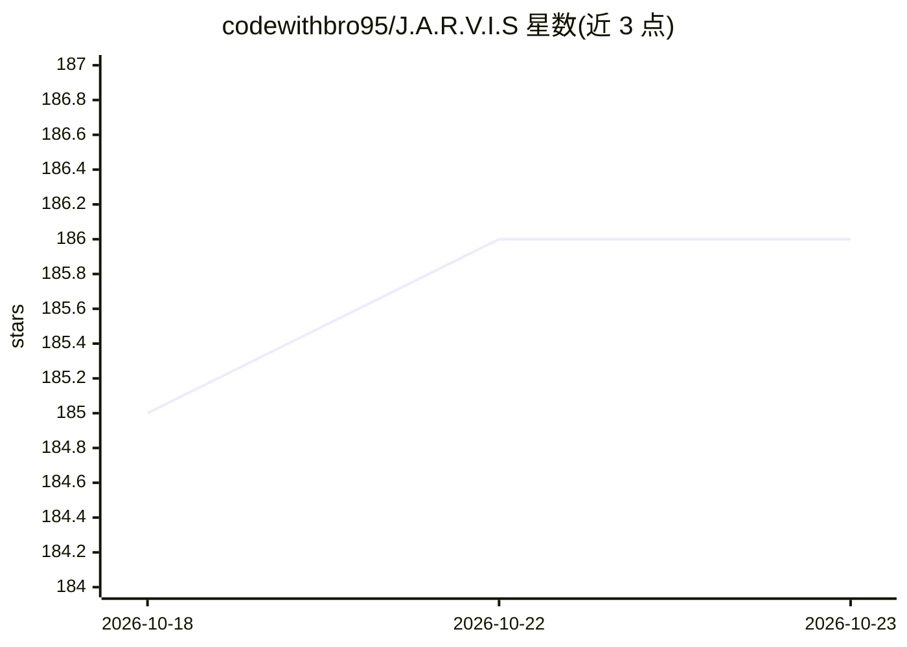

# codewithbro95/J.A.R.V.I.S

⭐ 186 · Jupyter Notebook · MIT · 推送 2026-04-25 · [GitHub](https://github.com/codewithbro95/J.A.R.V.I.S) · [官网](https://youtu.be/4qOmHOBCtk8) · 个人维护

**漫威 J.A.R.V.I.S 风格的本地离线 AI 语音助手项目**

基于 Llama2-7b 微调的 J.A.R.V.I.S 对话模型（fotiecodes/jarvis），通过 Ollama 本地安装运行，宣称 100% 离线、以隐私为设计目标。项目含 Python 后端（NLP、语音处理、工具调用）、React+Electron HUD 界面（开发中）。已实现报时、浏览器搜索、播放 YouTube 视频、结合 llava 与摄像头的视觉问答；待办包括 Wikipedia 搜索、发邮件、Whisper 语音输入与声音克隆。TTS 使用 LuxTTS 本地处理。README 声明正在做架构大重构。

## 筛选速览

| 维度 | 判定 | 备注 |
|---|---|---|
| AI 角色 | `ai-native` | 本体是模型或模型工具 |
| 许可风险 | `permissive` | MIT |
| 部署形态 | `library` | 以包/库形式分发 |
| 模型依赖 | local-ok | 支持本地模型 |
| 硬件要求 | — | 无带数字的原话,不猜 |
| 安装摩擦 | `low` | 无编译、无系统依赖或容器化 |
| 成熟度 | `idea` | |

## 能力要点

- Llama2-7b 用自定义 J.A.R.V.I.S 对话数据微调，通过 Ollama 本地运行
- 支持日期时间查询、浏览器搜索、YouTube 播放等工具功能
- llava（Ollama 本地）驱动的摄像头视觉问答
- 本地 TTS（LuxTTS）与语音项目待办（Whisper 输入、声音克隆）

## 适用场景

- 在自己的机器上运行一个 J.A.R.V.I.S 风格的对话助手
- 语音/对话控制浏览器搜索和播放 YouTube 视频
- 结合摄像头让助手描述所见内容

## 场景标签

`AI 助手` `语音 Agent` `多模态` · 领域:对话与助手

## 证据(README 行号)

> L4: The J.A.R.V.I.S Large Language Model, 100% offline
> L19: - [x] Jarvis can tell you the current date and time just ask:) `Try: What time is it? what is the date of today?`

## 星数曲线

2026-10-18 185 → 2026-10-23 186（+1）

---
*卡片 v1 · prompt 1.4 · 生成 2026-10-22 · 置信度 high · 依据 README sha `a5010cd16071` · [字段定义](../../DATASET.md)*
