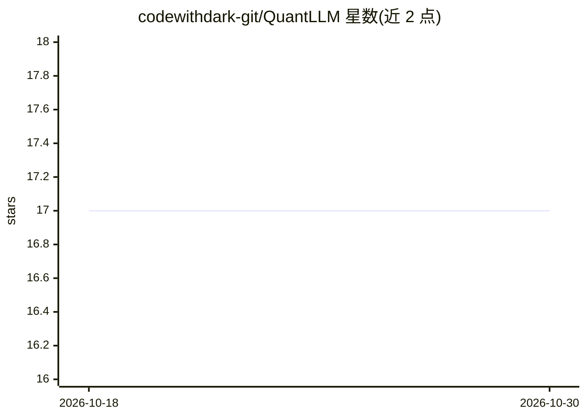

# codewithdark-git/QuantLLM

⭐ 17 · Python · MIT · 推送 2026-08-04 · [GitHub](https://github.com/codewithdark-git/QuantLLM) · [官网](https://pypi.org/project/quantllm/) · 个人维护

**一行代码加载、量化、微调、部署 LLM 的 Python 库**

面向开发者与研究人员的一体化 LLM 量化工具库：核心 API 是单个 turbo() 函数，加载任意 HuggingFace 模型时自动检测硬件（GPU/CPU、VRAM、计算能力），选择量化位数（2-16 bit，BitsAndBytes 4/8-bit 或 HQQ 2-8 bit）、dtype、group size、Flash Attention 与 offload。内置 LoRA 微调、GGUF/ONNX/MLX/SafeTensors 导出、带模型卡自动生成的 HF Hub 推送、OpenAI 兼容推理服务器与基准测试 CLI。通过 pip 安装，MIT 许可。

## 筛选速览

| 维度 | 判定 | 备注 |
|---|---|---|
| AI 角色 | `ai-ecosystem` | LLM/agent 周边工具 |
| 许可风险 | `permissive` | MIT |
| 部署形态 | `library` | 以包/库形式分发 |
| 模型依赖 | local-ok | 支持本地模型 |
| 硬件要求 | `gpu-8g` | |
| 安装摩擦 | `medium` | 含编译或系统依赖之一 |
| 成熟度 | — | 结构信号不足 |

## 能力要点

- turbo() 单函数加载并自动选择量化（2-16 bit，BnB/HQQ）
- LoRA 微调、多格式导出（GGUF/ONNX/MLX/SafeTensors）、HF Hub 推送
- OpenAI 兼容推理服务器，自动检测 GGUF 后端
- CLI 基准测试：tokens/sec、延迟、VRAM

## 适用场景

- 在显存有限的 GPU 上量化和运行大模型
- 将 HuggingFace 模型导出为 GGUF 并推送到 Hub
- 用 LoRA 在量化模型上做微调
- 本地起 OpenAI 兼容 API 做推理服务

## 场景标签

`模型量化` `微调` `推理引擎` · 领域:训练与推理

## 证据(README 行号)

> L20: That is the entire API. One function loads any HuggingFace model, auto-detects your hardware, picks optimal quantiz
> L43: |**Quantise**|Built into load|BnB 4/8-bit or HQQ 2-8 bit, no calibration data needed|
> L47: |**Serve**|`quantllm serve ...`|OpenAI-compatible API, auto-detects GGUF backend|

## 星数曲线

2026-10-18 17 → 2026-10-30 17（+0）

---
*卡片 v1 · prompt 1.4 · 生成 2026-10-30 · 置信度 high · 依据 README sha `ab23aa9b7cdf` · [字段定义](../../DATASET.md)*
